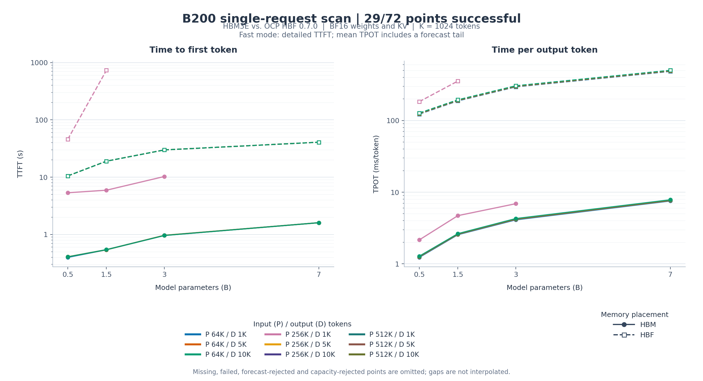

# B200 HBM/HBF 单请求扫描

报告刷新时间：**2026-10-18 23:13:55（北京时间 UTC+08:00）**。

已成功 **29/72** 个配置点（详细完成 0，预测完成 29）；预测安全检查拒绝 0 个；失败 0 个；容量不满足 0 个；尚未完成 43 个。

队列状态：**运行中**；队列记录已完成 29/72；等待运行 42 个。队列更新时间：2026-10-18 23:13:54（北京时间）。

修复后优先重测：**25 个点**。旧尝试保留在历史目录，只有 active points 的最新结果计入本报告；重跑不执行完整详细模式。

优先点位：qwen2_5-1_5b__HBM__P262144__D1024、qwen2_5-1_5b__HBF__P262144__D1024、qwen2_5-0_5b__HBM__P65536__D1024、qwen2_5-0_5b__HBF__P65536__D1024、qwen2_5-1_5b__HBM__P65536__D1024、qwen2_5-1_5b__HBF__P65536__D1024、qwen2_5-3b__HBM__P65536__D1024、qwen2_5-3b__HBF__P65536__D1024、qwen2_5-7b__HBF__P65536__D1024、qwen2_5-0_5b__HBM__P65536__D5120、qwen2_5-0_5b__HBF__P65536__D5120、qwen2_5-1_5b__HBM__P65536__D5120、qwen2_5-1_5b__HBF__P65536__D5120、qwen2_5-3b__HBM__P65536__D5120、qwen2_5-3b__HBF__P65536__D5120、qwen2_5-7b__HBF__P65536__D5120、qwen2_5-0_5b__HBM__P65536__D10240、qwen2_5-0_5b__HBF__P65536__D10240、qwen2_5-1_5b__HBM__P65536__D10240、qwen2_5-1_5b__HBF__P65536__D10240、qwen2_5-3b__HBM__P65536__D10240、qwen2_5-3b__HBF__P65536__D10240、qwen2_5-7b__HBF__P65536__D10240、qwen2_5-0_5b__HBM__P262144__D1024、qwen2_5-0_5b__HBF__P262144__D1024。

本轮修复重跑已处理 **25/25** 个；验收状态：**全部通过**。该组全部接受后继续原队列；仍有拒绝则暂停处理。

| 正在运行的模型 | 存储 | 输入/输出 | 开始时间 |
| --- | --- | --- | --- |
| qwen2_5-3b | HBF | 256K/1K | 2026-10-18 23:13:54 |

| 存储 / 模型 | 当前阶段 | 已完成 Prefill | Decode | 当前批次细节 | 进度记录时间（北京时间） |
| --- | --- | --- | --- | --- | --- |
| HBF / qwen2_5-3b | 准备启动 | 尚未记录已完成块 | 尚未记录 | 等待进度记录 | 未记录 |

Prefill 只在整个批次完成后增加已完成块数。当前批次任务数是局部工作进度，不代表整点完成百分比；Decode 后续步骤数也不直接等同于已输出 token 数。细粒度记录若没有实际执行标记，则显示为准备/估算。

| 参数 | 设置 |
| --- | --- |
| 模型 | Qwen2.5-0.5B (0.5B)、Qwen2.5-1.5B (1.5B)、Qwen2.5-3B (3B)、Qwen2.5-7B (7B) |
| 存储策略 | HBM、HBF |
| 单请求输入 | 64K, 256K, 512K token |
| 单请求输出 | 1K, 5K, 10K token |
| K 单位 | 1024 token |
| 物理权重语义 | canonical_shared_resident_weights_v1 |
| GPU 预设 | nvidia-b200-sxm-gpu |
| GPU BF16 峰值（TFLOPS） | 2250.0 |
| 仿真模式 | fast |
| Decode 采样策略 | adaptive |
| 误差目标（非逐点实测保证） | 10.0% |
| Decode 真实采样上限（步） | 128 |
| 请求数 | 1 |
| Batch size | 1 |
| 权重精度 | bf16 |
| KV 精度 | bf16 |
| 激活精度 | bf16 |
| Prefill 分块（token） | 2048 |
| 权重预驻留 | 是 |
| HBM 物理预设 | hbm3e_reference |
| HBM 容量（byte） | 180000000000 |
| HBM 接口带宽（GB/s） | 8000.0 |
| HBF 物理预设 | hbf_ocp_0_7 |
| HOST 暂存容量（byte） | 67108864 |
| HBF 容量（byte） | 549755813888 |
| HBF 独立 bank 数 | 256 |
| HBF 主机通道数 | 16 |
| HBF 读接口预算（GB/s） | 1536.0 |
| HBF 写接口预算（GB/s） | 1536.0 |
| HBF 每内部通道数据带宽（GB/s） | 96.0 |
| HBF 每主机通道在途总上限（研究假设） | 256 |
| HBF 每主机通道在途写上限（包含在总额内） | 64 |
| HBF 几何依据 | FlashLabAE 16 channels * 1 die/channel * 16 banks/die; target and LUN are singleton mapping levels |
| HBF 时序假设 | 4 us read, 75 us program and 2 ms erase are upstream exploratory assumptions, not OCP mandated latencies |
| HBF 队列假设 | 256 combined requests and 64 writes per host channel are local research assumptions; not a measured MOCS or an exact copy of upstream read/write queues |
| HBF 编程页（byte） | 4096 |
| HBF 读取粒度（byte） | 64 |
| HBF 读页延迟（ns） | 4000.0 |
| HBF 编程延迟（ns） | 75000.0 |
| HBF 擦除延迟（ns） | 2000000.0 |
| CPU 核数 | 72 |
| CPU 频率（GHz） | 3.0 |
| HOST DRAM 容量（byte） | 32000000000 |
| HOST DRAM 带宽（GB/s） | 44.8 |
| PCIe 代际 | 5.0 |
| PCIe 通道数 | 16 |

完整硬件参数、点位清单和指标定义见 [manifest.json](manifest.json)。
HBF 的器件延迟采用仿真预设值，不代表 OCP 规定的器件性能。

HBM3E 使用标准参考模型；当前 24Gb × 8H 组织未套用只支持 32Gb × 16H 的额外时序包。
独立 RoPE 每次生成并写入按 Q/K 广播展开的 sin/cos 表，两种部署均计入这项开销。
超过模型原生上下文的长度仅用于性能外推，不验证输出质量。

数据单位：原始 TTFT/TPOT 为 ns；图中 TTFT 为秒，TPOT 为毫秒/token。

**快速模式口径：Prefill 和 Decode 采样前缀为详细物理执行，尾段为预测。** TTFT 为详细结果，平均 TPOT 包含估算；资源占用、事务及物理状态只覆盖已执行前缀，不能当作完整逐 Token、逐事务结果。

10% 是误差目标；条件误差预算依赖模型假设，不能替代每个配置与完整详细模式的实测对照。未做完整详细对照的点保留原始 validation_status，不标为全请求误差验证通过。预测拒绝和容量拒绝是已处理终态，保留原因并继续后续点；代码执行失败需要处理。

[历史尝试记录](points_history/) 保留 **83** 份旧结果；历史拒绝不重复计入当前成功数、拒绝数或曲线。

每个面板用颜色区分 9 种输入/输出长度组合，用实线表示 HBM、虚线表示 HBF。横轴为模型参数量，纵轴为对数刻度；未完成、预测拒绝、容量拒绝和失败点留空。快速完成点的 TPOT 曲线为预测结果。

## 已成功的配置

| 模型 | 存储 | 输入/输出 | 模式 | TTFT（s） | TPOT（ms/token） | 真实/预测 Decode 步数 | 条件预算 | 完整对照状态 |
| --- | --- | --- | --- | --- | --- | --- | --- | --- |
| qwen2_5-0_5b | HBM | 64K/1K | fast（TPOT 估算） | 0.398209 | 1.23262 | 16/1007 | 0.393% | not_validated_against_full_detailed |
| qwen2_5-0_5b | HBM | 64K/5K | fast（TPOT 估算） | 0.40725 | 1.25743 | 16/5103 | 1.929% | not_validated_against_full_detailed |
| qwen2_5-0_5b | HBM | 64K/10K | fast（TPOT 估算） | 0.405918 | 1.27848 | 16/10223 | 3.804% | not_validated_against_full_detailed |
| qwen2_5-0_5b | HBM | 256K/1K | fast（TPOT 估算） | 5.33602 | 2.15957 | 16/1007 | 0.099% | not_validated_against_full_detailed |
| qwen2_5-0_5b | HBF | 64K/1K | fast（TPOT 估算） | 10.5068 | 122.958 | 80/943 | 1.259% | not_validated_against_full_detailed |
| qwen2_5-0_5b | HBF | 64K/5K | fast（TPOT 估算） | 10.5068 | 124.721 | 80/5039 | 2.780% | not_validated_against_full_detailed |
| qwen2_5-0_5b | HBF | 64K/10K | fast（TPOT 估算） | 10.5068 | 126.926 | 80/10159 | 4.636% | not_validated_against_full_detailed |
| qwen2_5-0_5b | HBF | 256K/1K | fast（TPOT 估算） | 45.7815 | 183.141 | 52/971 | 0.954% | not_validated_against_full_detailed |
| qwen2_5-1_5b | HBM | 64K/1K | fast（TPOT 估算） | 0.54028 | 2.55662 | 16/1007 | 0.391% | not_validated_against_full_detailed |
| qwen2_5-1_5b | HBM | 64K/5K | fast（TPOT 估算） | 0.540821 | 2.59927 | 16/5103 | 1.929% | not_validated_against_full_detailed |
| qwen2_5-1_5b | HBM | 64K/10K | fast（TPOT 估算） | 0.54239 | 2.638 | 16/10223 | 3.803% | not_validated_against_full_detailed |
| qwen2_5-1_5b | HBM | 256K/1K | fast（TPOT 估算） | 5.91366 | 4.70739 | 16/1007 | 0.098% | not_validated_against_full_detailed |
| qwen2_5-1_5b | HBF | 64K/1K | fast（TPOT 估算） | 18.9888 | 188.075 | 28/995 | 1.729% | not_validated_against_full_detailed |
| qwen2_5-1_5b | HBF | 64K/5K | fast（TPOT 估算） | 18.9888 | 190.914 | 28/5091 | 3.030% | not_validated_against_full_detailed |
| qwen2_5-1_5b | HBF | 64K/10K | fast（TPOT 估算） | 18.9888 | 194.307 | 28/10211 | 4.841% | not_validated_against_full_detailed |
| qwen2_5-1_5b | HBF | 256K/1K | fast（TPOT 估算） | 731.569 | 355.203 | 100/923 | 10.856% | not_validated_against_full_detailed |
| qwen2_5-3b | HBM | 64K/1K | fast（TPOT 估算） | 0.960735 | 4.11638 | 16/1007 | 0.392% | not_validated_against_full_detailed |
| qwen2_5-3b | HBM | 64K/5K | fast（TPOT 估算） | 0.965666 | 4.20184 | 16/5103 | 1.929% | not_validated_against_full_detailed |
| qwen2_5-3b | HBM | 64K/10K | fast（TPOT 估算） | 0.959603 | 4.28222 | 16/10223 | 3.803% | not_validated_against_full_detailed |
| qwen2_5-3b | HBM | 256K/1K | fast（TPOT 估算） | 10.2574 | 6.90755 | 16/1007 | 0.097% | not_validated_against_full_detailed |
| qwen2_5-3b | HBF | 64K/1K | fast（TPOT 估算） | 29.8572 | 295.042 | 28/995 | 2.093% | not_validated_against_full_detailed |
| qwen2_5-3b | HBF | 64K/5K | fast（TPOT 估算） | 29.8572 | 299.497 | 28/5091 | 3.643% | not_validated_against_full_detailed |
| qwen2_5-3b | HBF | 64K/10K | fast（TPOT 估算） | 29.8572 | 304.818 | 28/10211 | 5.419% | not_validated_against_full_detailed |
| qwen2_5-7b | HBM | 64K/1K | fast（TPOT 估算） | 1.6025 | 7.55381 | 16/1007 | 0.390% | not_validated_against_full_detailed |
| qwen2_5-7b | HBM | 64K/5K | fast（TPOT 估算） | 1.6025 | 7.68395 | 16/5103 | 1.927% | not_validated_against_full_detailed |
| qwen2_5-7b | HBM | 64K/10K | fast（TPOT 估算） | 1.6025 | 7.82967 | 16/10223 | 3.802% | not_validated_against_full_detailed |
| qwen2_5-7b | HBF | 64K/1K | fast（TPOT 估算） | 40.7237 | 485.125 | 16/1007 | 1.724% | not_validated_against_full_detailed |
| qwen2_5-7b | HBF | 64K/5K | fast（TPOT 估算） | 40.7237 | 492.448 | 16/5103 | 3.166% | not_validated_against_full_detailed |
| qwen2_5-7b | HBF | 64K/10K | fast（TPOT 估算） | 40.7237 | 501.197 | 16/10223 | 4.971% | not_validated_against_full_detailed |

## 快速预测的条件预算判定

下表是采样模型的条件界，**不是与完整详细模式对照得到的实测误差**。有匹配参考时，候选点、参考点各自的条件预算及 HBF/HBM 比值条件预算都必须 ≤10%；没有匹配参考时，仍使用独立对称预算 ≤4.7619% 的充分条件。配对判定使用方向区间，不把 4.7619% 的独立门槛简单放宽到 10%。

| 模型 / 存储 | 输入/输出 | 接受策略 | 单点条件预算 | 参考点条件预算 | 比值条件预算 | 判定 | HBM 参考点 |
| --- | --- | --- | --- | --- | --- | --- | --- |
| qwen2_5-0_5b / HBM | 64K/1K | 独立对称充分条件 | 0.387% | 未记录 | 未记录 | 接受 | 无匹配参考 |
| qwen2_5-0_5b / HBM | 64K/5K | 独立对称充分条件 | 1.923% | 未记录 | 未记录 | 接受 | 无匹配参考 |
| qwen2_5-0_5b / HBM | 64K/10K | 独立对称充分条件 | 3.798% | 未记录 | 未记录 | 接受 | 无匹配参考 |
| qwen2_5-0_5b / HBM | 256K/1K | 独立对称充分条件 | 0.097% | 未记录 | 未记录 | 接受 | 无匹配参考 |
| qwen2_5-0_5b / HBF | 64K/1K | 匹配方向区间配对 | 1.161% | 0.387% | 1.540% | 接受 | qwen2_5-0_5b__HBM__P65536__D1024 |
| qwen2_5-0_5b / HBF | 64K/5K | 匹配方向区间配对 | 2.738% | 1.923% | 4.552% | 接受 | qwen2_5-0_5b__HBM__P65536__D5120 |
| qwen2_5-0_5b / HBF | 64K/10K | 匹配方向区间配对 | 4.602% | 3.798% | 8.016% | 接受 | qwen2_5-0_5b__HBM__P65536__D10240 |
| qwen2_5-0_5b / HBF | 256K/1K | 匹配方向区间配对 | 0.906% | 0.097% | 1.003% | 接受 | qwen2_5-0_5b__HBM__P262144__D1024 |
| qwen2_5-1_5b / HBM | 64K/1K | 独立对称充分条件 | 0.385% | 未记录 | 未记录 | 接受 | 无匹配参考 |
| qwen2_5-1_5b / HBM | 64K/5K | 独立对称充分条件 | 1.923% | 未记录 | 未记录 | 接受 | 无匹配参考 |
| qwen2_5-1_5b / HBM | 64K/10K | 独立对称充分条件 | 3.797% | 未记录 | 未记录 | 接受 | 无匹配参考 |
| qwen2_5-1_5b / HBM | 256K/1K | 独立对称充分条件 | 0.096% | 未记录 | 未记录 | 接受 | 无匹配参考 |
| qwen2_5-1_5b / HBF | 64K/1K | 匹配方向区间配对 | 1.683% | 0.385% | 2.059% | 接受 | qwen2_5-1_5b__HBM__P65536__D1024 |
| qwen2_5-1_5b / HBF | 64K/5K | 匹配方向区间配对 | 3.014% | 1.923% | 4.822% | 接受 | qwen2_5-1_5b__HBM__P65536__D5120 |
| qwen2_5-1_5b / HBF | 64K/10K | 匹配方向区间配对 | 4.828% | 3.797% | 8.233% | 接受 | qwen2_5-1_5b__HBM__P65536__D10240 |
| qwen2_5-1_5b / HBF | 256K/1K | 匹配方向区间配对 | 9.693% | 0.096% | 9.798% | 接受 | qwen2_5-1_5b__HBM__P262144__D1024 |
| qwen2_5-3b / HBM | 64K/1K | 独立对称充分条件 | 0.386% | 未记录 | 未记录 | 接受 | 无匹配参考 |
| qwen2_5-3b / HBM | 64K/5K | 独立对称充分条件 | 1.923% | 未记录 | 未记录 | 接受 | 无匹配参考 |
| qwen2_5-3b / HBM | 64K/10K | 独立对称充分条件 | 3.797% | 未记录 | 未记录 | 接受 | 无匹配参考 |
| qwen2_5-3b / HBM | 256K/1K | 独立对称充分条件 | 0.096% | 未记录 | 未记录 | 接受 | 无匹配参考 |
| qwen2_5-3b / HBF | 64K/1K | 匹配方向区间配对 | 2.037% | 0.386% | 2.413% | 接受 | qwen2_5-3b__HBM__P65536__D1024 |
| qwen2_5-3b / HBF | 64K/5K | 匹配方向区间配对 | 3.624% | 1.923% | 5.421% | 接受 | qwen2_5-3b__HBM__P65536__D5120 |
| qwen2_5-3b / HBF | 64K/10K | 匹配方向区间配对 | 5.406% | 3.797% | 8.790% | 接受 | qwen2_5-3b__HBM__P65536__D10240 |
| qwen2_5-7b / HBF | 64K/1K | 匹配方向区间配对 | 1.698% | 0.384% | 2.073% | 接受 | qwen2_5-7b__HBM__P65536__D1024 |
| qwen2_5-7b / HBF | 64K/5K | 匹配方向区间配对 | 3.157% | 1.921% | 4.961% | 接受 | qwen2_5-7b__HBM__P65536__D5120 |
| qwen2_5-7b / HBF | 64K/10K | 匹配方向区间配对 | 4.964% | 3.796% | 8.363% | 接受 | qwen2_5-7b__HBM__P65536__D10240 |

各轮校准判定、方向上下界，以及擦除、GC、读写放置、缓存扰动和已有等待的分项均保留在 CSV/JSON 的原始预算记录中。

文件：[summary.csv](summary.csv) 保留全部终态的主指标、精度口径、采样记录、单点/配对预算、参考点及拒绝原因（无指标时留空）；[results.json](results.json) 保留全部结果、详细数据和参数。
