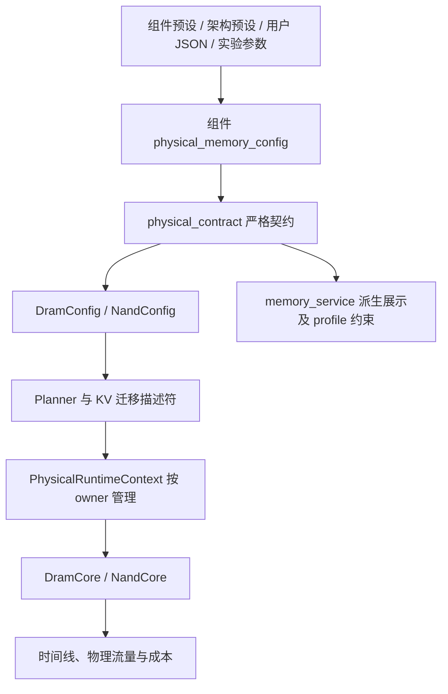

# 后端执行语义与成本计费审计

日期：2026-10-14。范围从此前的 DRAM / NAND Core 扩展到后端的输入、任务生成、执行、状态管理和结果汇总。本轮延续工作区中的第二、三轮 Core 修复，没有进行真实外部数据校准。

## 结论与验收范围

本轮发现的问题会分别影响实际执行时间、执行的算子集合、容量状态或结果报表，不能统称为显示问题。已确认的问题按下表修复，并用能复现原错误的小测试验证。完整回归结果在本文末尾记录。

当前场景编译与运行时路径中，HBM 物理访存仍交给 DramCore，HBF / SSD 物理访存交给 NandCore；GPU 计算仍使用声明的算力、指令工作量和资源重叠模型。直接调用独立成本估算器得到的 roofline 预估，与经过物理任务降低、运行时 Core 执行后的最终账单，是不同层次的结果。

完成条件：覆盖主要后端调用链；修复本轮确认的缺陷；验证任务依赖、状态恢复和时间 / 字节归属；交付测试结果及尚未建模的边界。审计和有限测试不构成“所有参数下不再有错误”的证明。

## 覆盖范围

| 环节 | 检查内容 | 验证方式 |
|---|---|---|
| 输入与后台作业 | CLI / Web 到场景规范化、校验、排队、取消、结果与回放 | 读取入口及校验链；排队后修改原输入的隔离回归 |
| 控制与任务生成 | 控制动作、Host / GPU 权重加载、每 GPU 命令、显式后续 DAG、容量覆盖、物理地址绑定 | 真实动态 Runtime 小例子；权重驻留跨 cohort 对照 |
| 计算 | GPU / CPU / CIM，原生内核 / L2、MMQ / MMVQ、精度、矩阵补齐、特殊函数、量化解包、PP 负载代理 | 按工作量手算的最小例子；单位与执行时间核对 |
| 互连与并行 | 路由、单向 / 双向共享资源、启动延迟、分片、collective | 实际事件核争用测试；字节守恒及整数边界 |
| 存储 | DRAM / NAND 状态、物理请求、资源别名、多槽、详细记录与加速路径 | 保留并运行前两轮专项回归；本轮核对与调度、汇总的接口 |
| Serving 与状态 | KV 页引用、共享前缀、写入、预取、提交 / 取消、缓存事务、容量估算、驻留消费者依赖 | 多页迁移故障注入；容量、物理身份、已发生费用及重试结果核对 |
| 调度与统计 | 普通事件核、编译复用、持续运行、流式保留策略、关键路径和流量聚合 | 四种汇总器对照；资源别名 / 多槽 / 截断 / 重叠访问；随机混合 DAG |
| 结果与回放 | 缺测值、跨批次 owner 归属、整数计数、批次回放的状态边界 | 汇总对照；明确标注独立重演而非历史物理状态恢复 |

## 计算与通信问题

| 问题 | 修复与实际影响 |
|---|---|
| BF16 仅凭位宽被当成 FP16 | 优先使用明确声明的激活 dtype。吞吐系数为 0.5 的 BF16 例子中，GEMM 从错误的 1 ns 修正为 2 ns；BF16-only 配置也能正常估算 |
| 注意力把多个独立 head 合并补齐 | 每个 head 单独计算矩阵 tile。8 个宽度 24 的 head，示例 MMA 数由 24 修正为 32；对应计算时间修正，逻辑 KV 字节不因此增大 |
| 合法的纯特殊函数负载被拒绝 | operations / read / write 为 0 而 transcendental work 为正时，仍执行并计特殊函数资源的时间 |
| CIM 接收激活尾部工作却静默忽略 | 对当前没有建模的 epilogue 明确报错，要求显式外围算子，避免算子免费消失；没有擅自添加 CIM 特殊函数硬件 |
| PP 分段负载代理忽略明确 head 宽度及非门控 FFN | 使用实际 Q / K / V / O 维度，并根据门控标志区分两次或三次投影，影响分段选择 |
| 分片和 collective 用浮点 ceil 处理整数 | 改为整数向上取整并校验整数输入；`2**53+1` 个元素不会在单分片中丢失 |
| 零字节链路仍收费或报空集合错误 | RouteHop 和 LinkService 统一为无工作、无启动时间、无费用 |
| 分页 KV 迁移把传播延迟也锁在带宽资源上 | 同步和异步迁移统一使用普通链路的联合准入：payload 占带宽、完整传输占 in-flight 名额。8 Gbps、20 ns 延迟、queue depth 2、两个 100 B 请求的例子，完成时刻应是 120 / 220 ns，原为 120 / 240 ns；字节只记在发送资源一次 |
| 批量估算接受复数并悄悄丢弃虚部 | 明确拒绝不合法的实数输入，避免按被截断的场景输出结果 |
| 原生内核外层包络残留 HBM 聚合预估 | 物理访存交给 Core 后，用实际内存完成跨度及保留的计算 / 依赖时间重建包络。相同 Core 都在 48 ns 完成的例子，仅改旧 HBMProfile 带宽曾把结果推到 1536 ns；修复后不再有这条预估下限。独立估算接口继续表达自己的 roofline 合同 |

## 任务生成与输入所有权问题

| 问题 | 修复与实际影响 |
|---|---|
| Host 权重加载在缓存命中或 NVMe 完成后丢掉控制字节 | bulk transfer 为 0 时仍保留控制描述符字节，后续控制动作不再按零载荷执行 |
| 多 GPU 控制任务按目标计时间，却各自登记全局字节 | 每个目标携带自己的 `control_byte_count`，修正资源流量归属 |
| 声明 `gpu_command_targets` 后忽略真实 continuations | 等所有 GPU 控制分支完成后，真实后续 DAG 执行一次；避免用合成 compute 替代用户声明的算子 |
| DRAM 显式分配范围在降低过程中丢失 | 64 B 访问声明的 4096 B 分配保持 4096 B，不再缩成访问长度 |
| 驻留权重默认跟随 cohort 换代 | 未声明 generation 的驻留权重保持 generation 0，并尊重显式权重版本；临时缓冲仍跨 cohort 区分 |
| DRAM / NAND 整数流量先转 float 再转 int | planner 流量汇总及物理任务合并计数保持整数累加，避免超过 `2**53` 的计数因中转 float 失真；时间仍为浮点数 |
| 初始容量检查忽略动作覆盖参数 | 根任务与后续控制任务一致应用服务时间和资源覆盖 |
| 后台作业持有调用者可变的嵌套配置 | 入队前取得独立输入；排队后或完成后修改原场景，不会悄悄改变本次运行或其回放 |
| MoE routed / shared expert 忽略非门控配置 | `gated_mlp=False` 的 up 输出 I，down 从 I 投影回 H，不再生成 2I 的 up_gate 或 SwiGLU；控制平面的权重、激活需求和融合候选同步修正，独立 shared expert gate 保留 |

## 状态与容量问题

| 问题 | 修复与实际影响 |
|---|---|
| 释放 prefix 后残留旧 prefix 标记 | 标记与实际存活引用一致；最后一个共享前缀释放后，独占页可以正常交接 |
| 同一 prefix 重复登记同一物理页 | 原子拒绝重复项，避免重复引用和不正确释放 |
| 共享 prefix 页允许被另一请求原地覆盖 | 共享页写入明确拒绝并提示需要 copy-on-write；私有后缀正常追加。当前没有声称已经实现自动复制 |
| 缓存 flush 后回滚没有恢复脏状态 | 回滚恢复脏行及写回义务；重试按同一份脏数据计费一次 |
| 异步迁移发布时先释放物理源，再更新可能失败的容量账 | 调整提交 / 取消 / 准备撤销的事务边界；账本拒绝或物理释放失败后，页 owner、绑定和容量保持一致，可以重试；已完成 I/O 不倒扣 |
| 一个请求的多页迁移发布半途失败 | 按整个请求恢复发布状态，避免第一页在 HBM、第二页在 HBF 而请求仍显示全部 offloaded；提交与取消都覆盖 |
| 外层重复 deepcopy 复制了需要保留的 Core 实例 | 由 executor 自己负责状态复制，恢复保留持续运行的真实 Core 对象身份 |
| NAND 工作区容量按 64 B 而不是整页对齐 | 上界与物理分配器一致。两个 64 B 缓冲、16 KiB NAND 页的例子预留 32 KiB，避免账本认为有空间而物理分配失败 |
| 多个并行读者的驻留依赖被最后一个覆盖 | 无 DAG 支配证据时保留所有不同消费者；淘汰等待较慢读者完成。只在真实 cohort 完成后清理对应锚点，避免既提前回收又无限保留历史 |

## 执行与统计问题

| 问题 | 修复与实际影响 |
|---|---|
| 用资源忙时推断资源释放时间 | 发布实际每个槽的完成点。Core 读从 0 到 30.5 ns，其中数据 burst 只有 2.5 ns，之后计算 100 ns：关键路径从错误的 102.5 ns 修正为 130.5 ns，包含 ACT / CAS 等前置时间 |
| Core 内部等待又被加到整个任务的起点 | 不把晚于 task start 的 Core 内部资源前驱当成任务起点阻塞。两个从 0 开始、最后在 33 ns 完成的重叠读，不再报告 63.5 ns 的路径 |
| 多槽或截断记录丢失关键路径连接 | 保存实际 lane 完成点；即使详细阶段被截断，仍可保留可靠的释放证据，不凭空构造未知阶段开始时刻 |
| 流式 NAND 账本停留在旧字段集合 | 保留 v2 的逻辑读写、内部字节、页数、准入峰值及可选观测；缺测传播为 None / partial，不把未记录或未建模数据写成 0 |
| 跨批次共享资源归属于第一个 owner | 汇总出现多个 owner 时标为共享资源本身，不把全部流量归给首个设备；单 owner 保持原归属 |
| 未标记预估或已解析任务在注册 chunk 时提前入账 | 只在实际 observe 时收取介质账单。construction preview、无标记预估、runtime result 三种输入均不再注册一次、执行又算一次 |
| 批次回放容易被理解为原始物理历史 | 加入 `physical_state_scope=isolated_fresh_context` 及明确说明：它是独立重演，不能恢复原运行的 DRAM 行状态、NAND 缓冲和争用历史 |
| 分页 KV 迁移在 Core 实际执行，却没有进入 serving 总账 | 增加独立的已执行 I/O 账本，汇入资源字节、忙时和介质流量。取消仍保留已提交阶段费用；只合并账单，不再次执行、不虚构 serving batch、不延长原时间轴 |
| 老格式物理记录缺字段时被补成“已记录的 0” | 可选字段按实际出现情况统计；缺测保持 None，部分记录保持 partial，并在 planner、流式与最终报告间传播。即使旧标签仍为 recorded，缺失数值也不能视作已记录 |

关键路径归因采用任务起止包络。Core 内部等待已包含在物理任务的持续时间内；这不是逐命令、逐 burst 的硬件关键路径解析。资源忙时、任务持续时间、排队等待、墙钟时间是不同指标：多个资源可并行，不能把它们直接相加当作完成时间。

## 成本口径与保留的模型边界

- 计算时间按声明的执行工作量与资源重叠关系计算。GPU 的 tile 补齐会增加发射工作量，不能只按逻辑 FLOPs 计所有资源。
- 链路逻辑字节、介质物理字节、NAND 内部传输字节和 host 字节分别有自己的含义，不能把不同口径重复计为同一份流量。
- DRAM 仍没有完整 JEDEC 刷新、tFAW / tRRD / tRAS、bank-group 约束或 FR-FCFS；PRE / ACT 占 bank，但没有另占命令总线。相关缺测字段不能解释成真实硬件成本为零。
- NAND 仍没有内容位、FTL、真实 GC、隐式擦除、掉电恢复。写确认表示可读取，不表示介质已经持久化。已经排定的 program 不会因上层取消而撤销。
- Core 不自动推断任意数据依赖，上层仍须提供读写、回收与迁移的因果关系。多页发布回滚只恢复失败的逻辑发布，不能倒扣已发生的物理 I/O。
- CUDA / Host 控制成本、GPU roofline 和部分内核工作量仍是当前实现的模型；未使用真实外部数据校准，也未声称其数值已等同硬件测量。
- 原生测量 surface 的计算资源拆分仍沿用既有比例模型。接入 Core 后重建执行包络，不等于恢复测量场景的全部硬件状态或完成独立物理校准。
- 活动曲线按批次 / 传输阶段包络汇总，不能作为逐命令实录。
- 非门控 FFN 的布尔开关没有表达 GELU / ReLU 类型，继续沿现有 dense 合同，不凭这个开关虚构激活。MoE 路由仍使用现有确定性平衡分配近似。

## 继续审计：跨模块交互（基于 0d2cabe）

本次继续检查执行链之间的交互，未把上轮修复重复算作新发现。下列问题均先复现再修复；有些改变时间和执行对象，有些只改变分项统计。

| 问题 | 修复与实际影响 |
|---|---|
| GPU 的 KV 地址与页池迁移地址分裂 | 通用单 rank 路径从当前 cohort 的页表产生真实页访问，使用同一个 buffer、代际和页内偏移。原来的 pool 页和独立 `kv:request:k/v` 双份分配合为一份；真实 Core 回归覆盖三轮 session 交接、冷迁移和热驻留 |
| 迁移代际被误当成 cohort 临时缓冲 | 页池分配显式标为外部所有；事件核仍跟踪使用者，但不在 cohort 结束或请求缓冲清理时自行释放。工作区上界也不再把已由页池预留的页重复计入 |
| 迁移未处理脏 L2 行 | 只写回源页对应代际的脏行，并等待真实 Core 写回完成后读取迁移源。释放只失效该代际；取消保留已执行费用，准备失败回滚同时恢复缓存脏位、Core 和账本 |
| 静态缓存预估与有状态 L2 的访问描述不兼容 | L2 使用完整原始逻辑访问，不能先按静态命中比例裁剪；物理字节数等同义字段严格转换，冲突时报错。完整 Serving + L2 + 页池迁移回归验证同一页身份、同一缓存实例、真实脏写回顺序及终止清理 |
| KV 页容量忽略 NAND 的物理分配粒度 | 分开记录逻辑载荷和各介质上的分配占用；迁移释放源介质占用、预留目标介质占用。4 KiB 逻辑页、16 KiB NAND 对齐、32 KiB HBF 的例子，两页即占满，第三页在提交 I/O 前被拒绝；传输载荷仍为每页 4 KiB。同步、异步双副本、取消及回滚按同一口径；保留角色配额，前缀驱逐按真实释放量停止 |
| NAND 请求过早等待 Host 线缆 | 删除整个请求对末端线缆的提前等待，让 Core 自己调度内部阶段。10 微秒线缆占用例中，读完成由约 14.842 微秒修正为 10.008 微秒；字典和类型化配置现在一致，实际传输仍等待线缆可用 |
| Serving 仍有 HBM 聚合带宽下限 | 移除资源争用策略中的 `hbm_bytes / HBMProfile.bandwidth` 时间下限，使用 lowerer 的内存执行结果；正式物理路径仍由 DramCore 计时。GPU 简化计算和实际迁移计时保留 |
| 原生注意力仍少算每个 head 的 MMA 补齐 | QK 与 PV 分别按独立 head 和矩阵维度补齐，不能合并尾部工作。head_dim=24 的例子，发射算量由 196608 改为 262144，逻辑 KV 字节不变 |
| Decode 忽略已选内核的 query tile | causal decode 使用 kernel descriptor 中的 query_tile=1；示例评分对数从 4096 修正为 64，而 Tensor 发射仍保留物理 MMA 补齐，不把逻辑工作量直接等同发射量 |
| 固定 source MMQ / MMVQ 的不支持合同被静默接受 | 固定 source 工作量与额外融合、native dispatch 与独立 MMVQ issue bound 的不兼容组合明确报错。普通 GEMM 已声明的融合仍有时间账 |
| TP 隐藏向量少算、残差进入了 all-reduce | 归一化和残差按各 rank 完整复制的 H 处理；先归约分片输出，再加复制输入，避免形成 `TP × 输入 + 分片之和`。H=256、FP16、TP=2 时，每 rank norm 读取从 256 B 改为 512 B |
| 门控 FFN 的奇数维分片不一致 | gate/up 各自分片后组成输出；I=513、TP=2 时，up 宽度从 513 改为 514，与两个 257 元素的半部及后续 down 一致；dense 和 shared expert 均覆盖 |
| 普通 A8 GEMM 输出与消费者存储不一致 | 普通解析输出遵循声明的 activation bits，不再单方面提升到至少 16 位；固定 source F32 仍为 32 位，累加精度独立。这是声明的解析存储合同，未声称新增真实量化 kernel |
| 编译模板跨请求串用 KV 地址和代际 | 物理 segment 缓存纳入请求身份；分页 cohort 的缓存键包含页表，并禁用不支持身份重绑定的片段重放。开启与关闭缓存的任务、依赖、成本和物理访问对照一致 |
| Host 累计工作量被当成串行墙钟扣除 | Host 与设备时间分别取实际任务区间并集，另列 Host 累计任务时间、重叠和空闲。两个 Host 与一个 GPU 都在 [0,10] ns 的例子，原报告 Host=20、GPU=0，现 Host=10、GPU=10、重叠=10。显式 DAG 的调度继续使用完整包络，不能把两项并集相加 |

本次验证仍包括上轮的 DRAM / NAND、状态回滚、费用归属和报告缺测传播用例。新定向回归在 `test_backend_cost_followup.py`、`test_backend_execution_followup.py`、`test_backend_lowering_followup.py`、`test_backend_serving_followup.py`、`test_backend_page_capacity_followup.py` 和 `test_live_execution_time_breakdown.py`。

新增边界：通用单 rank 的物理分页 KV 已贯通；TP / PP / EP 多 rank 和 native/source 专用布局未声明与页池一致的物理布局，目前明确拒绝这些组合。没有把拒绝解释为已经实现分布式迁移；DP 推理副本调度也不在本次实现和验证范围。Host / 设备区间仍是任务包络，包含任务内部等待，并非硬件逐指令活跃时间。独立估算器的解析合同与最终 Core 执行账继续分开。

页池容量现在按实际分配粒度核算，但没有声称消除不同尺寸分配形成的地址碎片；物理地址分配器仍负责最终准入。逻辑传输字节与物理容量分别报告，不能把 NAND 对齐尾部直接当成额外迁移载荷。

## HBM 深挖：执行与账单边界（基于 9dc3a0f）

本次沿正式后端的算子生成、L2、地址注册、DramCore、页池迁移、回收和汇总继续检查。重点是上层声明与 Core 真正执行的对象是否一致，以及失败恢复是否改变后续时间和费用。以下是本轮新确认的问题，未重复计入此前修复。

| 问题 | 修复与实际影响 |
|---|---|
| 自定义 HBM owner 静默绕过 DramCore | 已解析的 `custom-hbm` 又被改名为 `hbm0.custom-hbm`，QKV 的 263,680 B 流量因而未降低成物理任务。现在使用准确的 owner，单 rank 和双 rank 自定义 owner 均实际提交 Core；旧错误命名未降低的流量明确报错，禁止聚合回退 |
| 多命令槽下 CAS 绕过尚未完成的 ACT | 独立保存当前行激活完成时间，并在详细、Python 折叠、Numba 单次及批量路径中保留。ACT 在 100 ns 完成、首次写在 101 ns 完成的例子，后续读原为 102 ns，修正为 151 ns；没有把写恢复期错误串到同一行后续 CAS |
| L2 与 HBM 的身份、代际或长度不一致 | 输入／权重／输出明确声明 7／5／9，旧缓存描述却是 7／0／7；匿名输入或直接物理描述也可能另起名字。现在优先使用完整物理访问，分别保留身份、代际、偏移及分配长度；权重 4→5 版本切换会真实 miss |
| 用代际推断存储分区和释放时机 | `allocation_arena` 明确区分驻留与工作区，代际只标识数据版本。HBM 32 KiB、工作区 4 KiB、KV 页 8 KiB 的例子，回迁 gen2／gen4 不再因被误塞进工作区而失败；版本化权重也保持驻留。显式 workspace 的 gen0 可以正常回收，请求所属驻留缓冲仍在终止时释放 |
| 显式地址绕过缓冲身份和范围检查 | 缓冲登记在地址 0，却可指定地址 8192 写入。现在 buffer／generation／offset 与显式地址必须一致，范围越界或代际不符在执行前拒绝，失败不留下 Core、容量或费用状态；预估地址仍按运行时分配器重绑定 |
| 被拒绝的扩容先改变了原分配 | inferred 64 B 缓冲请求扩为 128 B，同时给出冲突地址，原先抛错后大小已变为 128 B。现在先校验再发布，失败保持原分配，后续分配地址也不变 |
| 重复访问描述丢失分配事实 | 相同或更小范围中补充的驻留属性原先被忽略；较大范围也可能覆盖此前的显式地址或别名。现在按 buffer／代际合并这些事实，范围取足够长度，冲突明确拒绝；不再出现工作区预算认定驻留、实际分配却进入工作区 |
| L2 多范围访问共用了最后一条绝对地址 | 两段访问分别是 base+0、base+64，旧预览只留下后一段地址，再与前一段 offset 拼接，推导出错误基址。现在先合并显式分配基址，再加每条缓存访问自己的偏移；正序、逆序描述得到相同 Core 地址 |
| 页池公开缓存访问接口导出第二套 KV 身份 | `cache_accesses` 现在从真实执行器导出同一 buffer、代际和分配长度。共享前缀、session 交接及回迁后访问原来的物理分配，分配数量不增加；没有执行器的逻辑模式保持原合同 |
| 缓存回滚改变 LRU 淘汰顺序 | 原日志只保存一条缓存行的首次变更，flush 与多次逐出交错后回滚可改变顺序。现在逐次逆序撤销触及行，不在正常路径复制全缓存。真实 HBM 例子由错误的读 64 B＋写 64 B、53.5 ns，恢复为读 64 B、40.5 ns，与未发生失败的基线一致 |
| JSON 分配快照不能恢复排在目标前的别名 | 按 buffer／代际依赖顺序恢复，支持多级别名和混合表示；缺失目标、错误代际或循环依赖拒绝。显示排序不再改变恢复结果及后续 HBM 地址 |

新增定向用例位于 `test_hbm_address_deep_followup.py`、`test_hbm_allocator_snapshot_followup.py`、`test_hbm_core_deep_followup.py`、`test_hbm_lowering_deep_followup.py`、`test_hbm_runtime_deep_followup.py`。覆盖真实 Core 提交、跨执行模式状态、重复回滚、容量与字节账；全套还覆盖 NAND 和此前后端回归。

最终代码全套回归：**634 项测试、48 项子测试通过，耗时 110.43 秒**。相对 `9dc3a0f` 的 584 项测试、40 项子测试，新增 **50 项测试、8 项子测试**。源码差异及新增测试的空白检查通过。详细、Python 折叠、Numba 单次／批量均有实际执行回归；额外小范围对照覆盖非标准 DRAM 几何与缓存混合回滚，没有用这些对照代替全套验收。

本轮保留边界：GPU 计算仍使用声明的解析模型，本轮未新增完整 JEDEC 或刷新机制。有状态 L2 的多 backing owner 内核，以及未声明物理布局的 native／多 rank 分页组合仍明确拒绝。页池公开接口保留均匀 token 行合同，Serving 的专用 K／V 页内布局由其 lowerer 负责。没有开展外部实测校准或重跑旧 TPS 实验。

## 上轮验证与交付（基于 0d2cabe）

基于 `0d2cabe` 的继续审计共修复上表 **16 类问题**。最终全套回归：**584 项测试、40 项子测试通过，耗时 107.36 秒**；相比起点的 508 项测试，新增 **76 项**。源码差异空白检查通过。

容量专项覆盖同步与异步双副本、提交失败、账本拒绝、取消、准备撤销、释放、前缀驱逐、已有页挂接物理执行器，以及 Serving 角色配额。完整 Serving 联动覆盖跨轮会话的真实 KV 页身份和代际、有状态 L2 脏写回、迁移与最终清理。工作区容量检查也覆盖页身份经过 JSON 转换后的表示。

本次未进行外部实测校准，未在 CuPy / CUDA 设备上执行验证。此前的大规模吞吐实验仍是历史结果；本次验收是执行语义和成本账修复及回归，不包含旧 TPS 图重跑。

## 上一轮验证与交付

最终全套回归：**508 项测试、40 项子测试通过，耗时 95.63 秒**。相比本轮开始时的 360 项测试，新增 **148 项**。源码差异空白检查通过。

```powershell
$env:PYTHONPATH='src'
./.venv/Scripts/python.exe -m pytest tests -q
```

普通详细执行、编译执行、持续运行汇总及流式汇总的关键路径进行交叉对照；专项测试覆盖多槽、别名、受限明细及重叠 Core 访问。另用 100 个固定随机种子的混合 DRAM / 计算 DAG 做补充对照，四种汇总器结果一致。故障注入覆盖缓存 flush、单页和多页迁移发布、取消、撤销与容量账拒绝。

计算检查包含 NumPy 批量后端，没有在 CuPy / CUDA 设备上执行验证。模型依赖的外部实测校准不属于本轮范围。

本轮新增的专项回归位于：

- [计算、通信与并行](F:/codex_project/37_LLMsim/heterollm-sim-4.0.0/tests/test_backend_cost_semantics.py)
- [执行、关键路径与账本](F:/codex_project/37_LLMsim/heterollm-sim-4.0.0/tests/test_backend_execution_semantics.py)
- [任务降低与控制流](F:/codex_project/37_LLMsim/heterollm-sim-4.0.0/tests/test_backend_lowering_semantics.py)
- [后台输入隔离](F:/codex_project/37_LLMsim/heterollm-sim-4.0.0/tests/test_backend_jobs_semantics.py)
- [Serving 状态与容量](F:/codex_project/37_LLMsim/heterollm-sim-4.0.0/tests/test_backend_serving_semantics.py)
- [报告总账与缺测传播](F:/codex_project/37_LLMsim/heterollm-sim-4.0.0/tests/test_backend_reporting_semantics.py)
- [原生内核、物理存储与发射工作量](F:/codex_project/37_LLMsim/heterollm-sim-4.0.0/tests/test_native_kernel_physical_cost.py)

前两轮 Core 修复和具体测试见 [DRAM / NAND 深度审计](F:/codex_project/37_LLMsim/heterollm-sim-4.0.0/artifacts/hbf_hbm/core_semantics_deep_audit.md)。本轮验收包含这些回归，不把历史测试数重复计作本轮新增。

此前 19 组大规模 HBF / HBM 实验及 TPS 图未随本轮修复重新运行，仍是历史结果。触发上述执行或计时缺陷的场景可能得到不同吞吐与延迟；只影响汇总的缺陷则改变报表。小回归不能替代整套实验重跑。

## HBM 几何、配置来源与后端分层（2026-10-14）

本轮在上一轮未提交修复之上继续审计。结论：确有配置入口和派生元数据不一致的问题，但没有发现 DramCore 三条执行路径重复计算 stack/die 容量。已修复的错误与仍然采用的等效建模假设必须分开理解。

### 配置实际由哪里提供

| 层次 | 文件 / 入口 | 职责 |
|---|---|---|
| 参数类型 | `src/heterollm_sim/memory_types.py` / `DramConfig` | 几何、容量、接口带宽和时序的类型与数学约束；`make_hbm_config()` 是显式使用的示例默认配置，不是实物器件库 |
| 等效配置生成 | `src/heterollm_sim/physical_presets.py` | 统一生成完整的等效 DRAM/NAND 参数；从组件目录中抽出，reference 与架构不再依赖目录内的私有生成函数 |
| 组件目录 | `src/heterollm_sim/component_presets.py` | HBM3/3E/4 等单组件模板及其来源、假设；调用上述生成器 |
| 架构目录 | `src/heterollm_sim/architecture_presets.py` | 每个 HBM 节点、端口、链路及容量/带宽拆分；通道数显式传递，不再统一硬编码为 16 |
| 默认场景 | `src/heterollm_sim/reference.py` | 参考系统的 8 个独立 HBM，每个组件持有自己的完整配置 |
| 用户输入 / 实验输入 | 场景 JSON 的 `hardware.components[].metadata.physical_memory_config`；`scripts/accept_hbf_hbm.py`、`scripts/calibrated_hbf_profiles.py` 等 | 用户或实验显式选择参数；不同实验可以使用不同几何，不能据此声称它们参数完全相同 |
| 正式校验 | `src/heterollm_sim/physical_contract.py` | 组件、任务、迁移和运行时共同使用的严格契约，拒绝不完整几何；区分 Core 物理上限与 profile 有效值 |
| 实际执行 | `data_motion.py` → `dram_core.py` / `nand_core.py` | 每个物理 owner 持续保留一套 Core、队列、地址分配和计费状态；预览与正式执行采用一致的配置正规化规则 |

统一的是**执行契约与 Core 配置**，不是把所有实验强制设成相同参数。底层 Core 单元实验可以直接给完整的 typed config；完整 LLM 实验还要经过场景解析、任务编排和事件调度。GPU 的计算与片上 SRAM 模型继续保留自身职责；HBM 的物理事务由 DramCore 执行。



### 几何语义与参考值

`lane_count = data_lanes`（显式给出时），否则为 `channels × subchannels_per_channel × pseudo_channels_per_channel`。

`bank_count = ranks_per_channel × bank_groups_per_rank × banks_per_group`。

`geometry_capacity = stacks × dies_per_stack × lane_count × bank_count × rows_per_bank × row_bytes`。

显式可见容量必须为正、burst 对齐且不超过几何覆盖上限；它可以小于完整几何容量。`data_lanes` 同时覆盖数组的 lane 维度和数据线数，并非只调带宽。Core 的 bank 身份包含 stack、die、lane、rank、bank group、bank；数据和命令接口按 lane 共享，整个 Core 共用请求准入窗口。因此 `stacks × 2` 不会隐式把接口带宽也乘 2。独立 HBM 堆叠应建成独立组件/owner，参考系统正是如此。

默认 reference 的每个 HBM 为：16 GiB，1 stack × 1 die，16 channel × 1 subchannel × 1 pseudo-channel，每 lane 16 bank、每 bank 8192 row、每 row 8192 B；burst 64 B，接口 512 GB/s，等效每 lane 位宽 64 bit、速率 4000 MT/s。8 个组件的声明总量为 128 GiB / 4096 GB/s；这不是任何负载保证能达到的总吞吐率。

上述 bank/row/时序属于明确标注的等效假设，没有在本轮声称完成真实器件校准。`make_hbm_config()` 的默认值为 16 lanes / 32 GiB / 409.6 GB/s，而裸低层 parser 的 HBM 缺字段默认值不同；已补充其用途说明，正式执行 mapping 入口现在拒绝缺字段，不能再静默套用这些默认值。

对 `2 stacks × 3 dies × 4 lanes × 12 banks × 2 rows × 256 B` 的完整小几何检查：2304 个 burst 地址无别名；detailed、numeric、fold 三路径均得到 610 ns、288 个 bank、4 根数据线和 147456 B 流量。`data_lanes` 覆盖默认乘积后，展示用的 channel/subchannel 坐标可能重复，但权威 lane 编号仍唯一；未发现内部执行按展示坐标错误合并。

### 本轮修复

| 问题 | 影响与修复 |
|---|---|
| 架构入口硬编码 HBM 16 通道 | HBM4 明确声明 32 通道时仍被生成 16 通道，靠反推双倍等效速率保住总带宽，改变 bank 并行和排队条件。现由明确端口/构造参数贯通通道数；缺失或多端口歧义拒绝，已有完整配置不被覆盖 |
| Core 与服务报告方向上限不一致 | 可出现 Core 读 256 GB/s，但派生服务报告 512、profile 有效读 384。统一校验显式读/写声明及 profile，物理报告只取 Core 原始 shared/read/write；shared 接口上限也不再误用最大方向值代替 |
| JSON 省略 profile 带宽时采用另一套默认推导 | 合法的非对称 Core 可能被补出越界写带宽；现在使用同一物理契约补齐，保留用户明确提供的值 |
| 多个 HBM 默认 owner 合并 | 共用 `hbm.channel` 模板可能静默共用一个 Core、队列和 allocator。模板占位名现在按组件生成独立 owner；明确指定的自定义 owner 保留 |
| 任务执行入口缺完整参数门槛 | 手工 TaskSpec 仅给 kind/容量也能执行，静默采用默认行组织与时序。任务、runtime、preview、迁移、relay 和页池的物理描述均接入统一严格契约；页池逻辑预算与物理容量仍分别处理 |
| repr 文本比较导致假几何冲突 | metadata 键顺序或 runtime 自动补充资源前缀会导致同一配置不能复用。改为先按 owner 正规化再比较 typed config；创建时隔离嵌套 metadata，避免调用方原地编辑改变正在执行的 Core |
| 配置生成层依赖组件目录私有函数 | 等效参数生成器移到 `physical_presets.py`，供组件目录、架构目录、reference 共同使用；运行时不能调用它作为缺字段回退 |

较小的组件带宽声明仍可用于限制旧 profile 的有效值，**不会重新设置 Core 时序**。需要改变真实执行带宽、行时序或准入窗口时，应修改 `physical_memory_config` 中对应参数；旧 profile 的时延/事务粒度字段仍是兼容元数据，不替代 Core 参数。派生 `memory_service.physical_*` 已不能冒充独立硬件配置，也不能绕过 Core 上限校验。

### 验证与范围

本轮新增配置、运行时和几何来源回归共 44 项；最终整套 `pytest tests -q`：**678 passed、48 subtests passed（113.65 s）**，`git diff --check` 通过。未重新生成历史大型 TPS 图，也未进行外部实测校准。本轮重点是配置一致性、几何输入和后端执行边界；没有把 planner/serving 的整体大文件拆分包装成本轮已完成的工作。

## DRAM bank group 专项审计（2026-10-14）

完善前的审计结论：**几何层已实现，组级调度和时序层未实现，不能称为 bank group 完整建模。** 以下记录当时的复现；随后实现的修复见文末“Bank group 时序完善”。没有套用外部器件时序数值。

### 已有语义与缺口

| 项目 | 当前实现 | 影响 |
|---|---|---|
| 几何、容量、地址 | `memory_types.py:283` 计算 rank×group×bank；`memory_mapping.py:56` 解码 group；bank 身份保留完整 group 坐标 | 不是纯显示字段；改变总 bank 数会改变几何，但不等于实现组竞争 |
| 行状态 | 每 bank 独立 open row、ACT 完成及恢复时间 | 已覆盖单 bank 状态，未发现分组引起地址别名 |
| 同组／异组 CAS 间隔 | `dram_core.py:264` 仅使用 lane 的统一 `burst_interval_ns` | 不区分同组、跨组访问，也没有 A→B→A 的组历史限制 |
| ACT 间隔和窗口 | 没有跨 bank 的 tRRD 或 tFAW 准入状态 | 不同 bank 的多个 ACT 可以同时发生；当前 PRE/ACT 也不另占命令总线 |
| 写转读 | `write_to_read_ns` 约束数据线切向 | 不是完整的、按组区分的读命令准入约束 |
| 加速执行 | `_compiled_dram.py:60` 给内核的是总 bank 数；group 用于资源名称 | 详细、numeric、fold、numeric_batch 一致地缺失组级约束，并非只有快路径漏掉 |
| 计费 | EventKernel 接收 Core 实际时间线和流量 | 未见现有组成本重复收取；缺失时序也不会自动被成本层补上 |

`DramCore` 类说明（`dram_core.py:70`）已明确排除 bank-group-specific timing、tFAW/tRRD/tRAS 等完整 JEDEC 约束。此前整套测试通过证明的是已实现语义的一致性，不能证明这些未实现约束已被覆盖。

### 实际执行复现

保持 1 lane、总 16 banks、每 bank 4 行、512 B/行、64 B/burst；容量 32768 B。显式测试参数为 open=10、close=7、read_latency=5、write_latency=3、burst_interval=2、read_recovery=1、write_recovery=6、read_to_write=4、write_to_read=9 ns，接口 64 GB/s。这些值仅用于可控微例。

依次读取 `[0,8192)`、写入 `[8192,16384)`、再次读取 `[0,8192)`。改变分组为 `1×16 / 4×4 / 8×2 / 16×1`，分别运行 detailed、numeric、fold、numeric_batch，16 种组合的完成时刻均为 **[270,530,782] ns**，物理流量 **24576 B**、资源 busy 总和 **1856 ns**，行命中／冲突计数一致。

同一配置的 `4×4` 分组下，访问同组 bank1 与跨组 bank4，第二次读取都在 **18 ns** 完成；五个不同 bank 的 ACT 均可发生于 **0–10 ns**。另一个最小 Core→EventKernel 微例中，同组与跨组两次 64 B 读取都得到命令起点 `[0,2] ns`、完成时刻 `[4,6] ns`；Core 与 Kernel 均记录命令忙时 4 ns、数据忙时 2 ns、总流量 128 B，没有额外流量。

因此，当前模型不能用于判断 bank-group 局部性对 Decode TPS 的影响。统一命令间隔的取值可能对某类访问过于乐观、对另一类过于保守，不能给所有负载一个固定修正倍数。

### 完善时必须一起处理的层级

1. 在 `DramConfig` 增加明确的同组／异组 CAS、ACT 间隔及 ACT 窗口参数；按实际目标内存的约束定义其含义，不从代际名称猜数值。当前通用预设的 4组×4bank 仍是等效假设。
2. 在 Core 维护组和上层共享范围的历史；不能只记最后一次访问的组，否则 A→B→A 会漏约束。组间隔与已有命令资源可用时间共同限制准入，应取最大值，不机械相加。
3. 组约束首先影响命令可发出时间和完成包络，不增加传输字节；等待时间不能全部算成数据线占用。
4. 新可变组状态必须纳入 `data_motion.py` 的 snapshot/restore；当前未知状态字段按引用保存，直接新增字典会导致失败回滚失效。还需更新有限时序保护。
5. 同步修改编译打包、回写和折叠递推；未适配的加速路径应对启用新约束的配置回退，不能让同一配置走出两套语义。
6. 验收至少覆盖同组／跨组／A→B→A、独立 lane/rank、共享命令资源、快慢路径切换、失败重试和重复恢复，以及新增等待不增加物理字节。

规范含义核对采用 AMD 的 [DRAMTMG4 控制器文档](https://docs.amd.com/r/en-US/ug1087-zynq-ultrascale-registers/DRAMTMG4-DDRC-Register)：其 DDR4 字段明确区分同 bank group 的 tCCD_L 与 tRRD_L。该资料用于核对约束类型，没有将 DDR4 数值套到 HBM，也没有进行外部实测校准。


## Bank group 时序完善（2026-10-14）

已将组级约束接入实际 DramCore 执行、统一物理配置入口、组件编辑器及运行时回滚。HBM、DDR、LPDDR 和 GDDR 共用这一实现；它补齐本次审计指出的组级时序缺口，仍不是完整 JEDEC 控制器。

### 参数与执行规则

所有字段都位于同一 `physical_memory_config`，单位 ns；新增字段默认 0，**逐项 0 表示不启用该项约束**。旧完整配置可省略这些字段，不会按代际名称推断厂商数值。现有等效预设保留零值，并在假设列表中明确说明组时序尚未指定。

| 新增字段 | 准入条件 |
|---|---|
| `column_same_group_ns` / `column_different_group_ns` | 同组／跨组的同方向列命令起点间隔；分别保留 READ→READ、WRITE→WRITE 历史 |
| `activate_same_group_ns` / `activate_different_group_ns` | 同组／跨组 ACT 起点间隔；ACT 表示打开一行 |
| `four_activate_window_ns` | 共享作用域中四次 ACT 的滚动窗口；第五次最早可在第一次起点加窗口长度时发出 |
| `write_to_read_same_group_ns` / `write_to_read_different_group_ns` | 同组／跨组 WRITE 数据结束至 READ 命令起点的最小间隔 |

共享作用域为 `(stack, die, lane, rank)`。每个组保留独立历史，因此 A→B→A 会同时满足 A 的较早历史与 B 的较近历史。四次 ACT 窗口按时间排序维护日历，并先查询实际 bank 资源可用时间；它允许在未来预约之前合法插入 ACT，只按请求有效到达时间清除已经过期的历史，不强制所有 ACT 或所有方向的列命令整体串行。组时序、bank 就绪和命令资源就绪共同决定最早可发出时刻，取约束的最大值；等待不新增资源占用，也不增加物理字节。已有 `write_to_read_ns` 仍约束数据总线切向，与新增的读命令门槛分别生效。

启用任一新增约束后，摘要、批次及通常会请求 numeric/fold 加速的调用统一回退到精确逐 burst 调度。结果包含 `bank_group_timing_enabled` 和摘要路径的 `bank_group_timing_fallback` 标识。尚未在编译/折叠递推中优化组状态，长请求可能比原加速路径慢；不会跳过时序来维持性能。全零配置继续走原有快路径。

新增嵌套状态 `_bank_group_state` 已纳入运行时 snapshot/restore 的深拷贝及有限时序溢出保护。预览隔离、执行失败后重试和同一快照重复恢复均覆盖新状态。最终验收检查时序、字节和资源占用。

### 可控微例结果

显式合成 HBM 几何：1 lane、2 groups×4 banks、每 bank 4 行、每行 512 B、64 B/burst、64 GB/s；open/close/recovery 为 0 ns，读写 pipeline 为 3 ns，统一命令占用为 2 ns。组列命令同组间隔 10 ns、跨组间隔 4 ns，其他新增参数为 0。每次请求均在 0 ns 到达。下列数值验证调度规则，不代表实物 HBM 的参数或性能。

| 访问序列 | 全零时完成时刻（ns） | 开启组列命令约束后（ns） | 两种设置下均相同的流量／忙时 |
|---|---|---|---|
| A0→A1，同组不同 bank | [4, 6] | [4, 14] | 128 B；命令 4 ns、数据 2 ns |
| A0→B0，跨组 | [4, 6] | [4, 8] | 128 B；命令 4 ns、数据 2 ns |
| A0→B0→A1 | [4, 6, 8] | [4, 8, 14] | 192 B；命令 6 ns、数据 3 ns |

另将列命令组约束置零，仅设置 ACT 同组 7 ns、跨组 3 ns、四次激活窗口 40 ns。A0→B0→A1→B1→A2 的 ACT 起点为 **[0,3,7,10,40] ns**；第五次被四次激活窗口推迟。Core→PhysicalService→EventKernel 的集成微例同样使完成时刻从 [4,6,8,10] 变为 [4,14,18,24] ns，始终保持 256 B、命令忙时 8 ns、数据忙时 4 ns。

### 范围边界

本轮未添加外部实测校准，未把现有预设的零值替换成臆测的 HBM 时序，也未重新生成大型 TPS 历史图。要让指定实验体现组竞争，需要在实验采用的 `physical_memory_config` 中显式设置以上参数。刷新、tRAS、PRE/ACT 对共享命令总线的占用、命令重排策略仍不在当前简化 Core 的范围内。


### 完善后的验证

新增 105 项 bank group 专项测试通过（配置/UI 62、Core 32、运行时 11），覆盖同组／跨组／A→B→A、逐项关闭、四维作用域隔离、写转读与数据总线切向、窗口边界、资源别名／多执行槽、有限数溢出、摘要／批次回退、失败重试及重复恢复。

独立窗口检查使用小整数时间穷举 24156 个合法 ACT 历史与候选下界组合，分别检查不剪枝和按到达水位剪枝的结果，共 48312 次对比；另检查 400 个混合同组／跨组 ACT 间隔案例，均与暴力寻找最早合法时刻的结果一致。实际资源集成检查中，已有四次 ACT@100 ns、窗口 25 ns 时，空闲 bank 仍可在 0 ns 激活；若其别名资源有两个执行槽，分别在 90/200 ns 可用，则第五次 ACT 正确移到 125 ns。

最终整套 `pytest tests -q`：**739 passed、48 subtests passed（113.37 s）**。JavaScript 语法检查及 `git diff --check` 通过。
