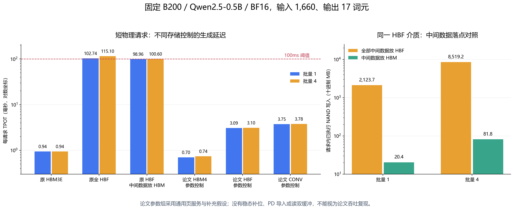

# Exploring HBF 论文与本仿真器结果对照

> 来源更正：本文的Qwen单请求与12个短物理控制经过原生后端；后来30组论文规模结果使用独立 `paper_*` 旁路模型，没有验收原生后端的PD、SRAM或Maverick，不能以“补齐原生能力”描述。原生本来就有连续批处理和TP/PP/EP等机制。历史数字保留在[旁路模型结果](exploring_hbf_reproduction.md)；现在改用原生实现的逐项映射、真缺项和新实验顺序见[原生后端对照安排](exploring_hbf_native_comparison.md)。原生完整论文矩阵尚未开始，旧扫描不恢复。

本文把用户提供的《Exploring High-Bandwidth Flash for Modern LLM Inference: Opportunities and Challenges》与我们已经完成的24个1K输出配置对照。现有实验支持“零HBM、全部模型数据放HBF的部署具有明显延迟代价”，但**不是论文实验的复现，也不与论文的容量、批量和系统吞吐收益结论矛盾**。模型、存储组织、中间数据位置、请求调度和指标范围均有实质区别。

论文依据为[用户提供的本地PDF](C:/Users/A/Downloads/HBF_HBM_LLM_2026-10-15/01_HBF/HBF05_2026_Exploring_HBF.pdf)及[作者论文主源 arXiv:2608.13868](https://arxiv.org/abs/2608.13868)。页码按这份4页PDF计算；正文为作者版本，不能把其中的未来器件假设当成OCP统一规定或现成产品实测规格。

## 对照范围与数据来源

已有实验目录是 `artifacts/b200_hbm_hbf_0_5b_7b_fast_20261018`，数字取自其中的 `analysis_1k.json`、`analysis_1k.md`、`manifest.json` 及 `points/*.json`。本表只包含输出1,024词元的24个当前成功结果，即4个模型、3种输入、HBM/HBF各一次，共12组配对。原始72点中的已完成长输出结果不纳入本次分析，32个取消配置不恢复。

- 输入64K、256K、512K分别是65,536、262,144、524,288词元，K按1,024计；论文输入/输出长度是数据集平均值，不应把它们当成相同请求。
- TTFT为从请求到达到首个可见输出词元的模拟时间，完整Prefill与首词元路径物理执行。
- TPOT为 `(最后一个输出时间−首个输出时间)/1023`，包含真实Decode采样前缀和预测尾段。
- `tokens/s = 1000 / TPOT(ms)` 是首词元后的单请求平均生成速率，不含Prefill等待，也不是连续批处理的系统吞吐。
- 所有延迟比均固定为HBF/HBM，大于1表示HBF更慢。速率比是延迟比的倒数。

## 论文实际研究了什么

论文第2页的方法与Table I研究五种GPU存储配置：HBM4、HBF、HBF+以及较保守的CONV、CONV+。它重点模拟PD分离中的**Decode节点**，而非把完整Prefill放到NAND上；连续批处理会在请求完成后补充新请求，使批量保持充满。在容量、片上SRAM和TPOT SLO等约束下选择数据、张量、流水线与专家并行组合，以最大化系统吞吐。

HBF与HBF+均把权重和KV Cache放NAND，但**不把一般中间数据都写入NAND**：HBF保留一堆HBM放中间数据，HBF+使用每堆40 MB的逻辑层SRAM，整GPU共320 MB。论文另为每堆HBF设置3.13 MB SRAM进行读取预取与双缓冲。第2页脚注明确指出，把中间数据写入NAND可能使每次Decode迭代的写流量增加至约100倍，带来性能和耐久性开销。

第3页Fig. 3比较0.1秒TPOT SLO下的最大每GPU批量；在8 GPU配置中，HBF和HBF+相对HBM4的批量分别可达1.3～4.5倍、1.7～5.3倍。Fig. 4比较对应系统吞吐，其收益来自更大的批量摊销权重访问及减少必要GPU数，不能解读为“单请求在HBF上必然比HBM快”。

第4页Fig. 5给出Decode延迟分解，其中“KV Write”包含PD分离下新接纳请求的KV导入写入。论文报告Llama4中该项占5～13.9%，而当前请求每一步新增KV的写入可与注意力计算重叠。Fig. 7讨论持续运行三年的每块P/E次数需求，大多数场景明显超过100K；单次请求的GC次数不能代替该寿命分析。

## 硬件与执行语义对照

### GPU与系统配置

|项目|我们已有24点|论文第2页方法及Table I|
|---|---|---|
|模型|Qwen2.5 0.5B、1.5B、3B、7B，Dense|Llama3 405B Dense、Llama4 Maverick MoE|
|GPU|单张B200，BF16 dense峰值2,250 TFLOPS|各存储方案使用相同的Rubin计算侧，扫描1～16 GPU|
|精度|权重、KV、激活均BF16|本文不替论文补充未在方法中完整说明的精度假设|
|请求与批量|每配置单请求，batch=1|连续满批，按SLO与容量寻找可行批量|
|输入/输出|65,536/262,144/524,288；输出1,024|平均约1,660/373、5.9K/499、103.5K/1.1K|
|阶段|完整Prefill＋真实Decode采样＋尾段预测|PD分离中的Decode节点|
|Prefill分块|2,048词元|扩展模拟器包含chunked attention；不是相同Prefill请求的TTFT对照|
|权重初始化|请求前完整resident预装，`canonical_shared_resident_weights_v1`|服务稳态常驻权重的研究；不据此推定两套初始化物理状态相同|
|共享权重|0.5B/1.5B/3B使用已证明共享的embedding/LM head物理表；7B untied|不同模型，不能套用Qwen共享关系|
|中间数据|所有模型张量选择HBM或HBF同一活动层；HBF方案零HBM|HBF用一堆HBM；HBF+用每GPU 320 MB SRAM|
|GPU缓存|L1/共享30 MiB、L2 50 MiB|显式SRAM中间数据层及每堆读双缓冲为另外的容量/调度假设|
|CPU|72核，3 GHz|论文方法未以这些HOST参数作为本对照的匹配依据|
|HOST DRAM|32 GB，44.8 GB/s，100 ns|不能把当前HOST内存自动视为论文的GPU逻辑层SRAM|
|主机链路|PCIe 5.0×16，63.015 GB/s，800 ns|GPU间NVLink 1,800 GB/s；节点间InfiniBand 100 GB/s|
|HOST staging|64 MiB，用于分段页与相关物理搬移|每HBF堆3.13 MB读预取/双缓冲；物理位置、路径和用途不同|
|服务目标|固定单请求完整长度；快速模式使用条件误差预算|在线TPOT SLO常用0.1秒，并改变SLO或研究离线场景|

当前GPU本身的L1/L2缓存不等同于论文HBF+的显式中间数据SRAM层；HOST staging也不等同于可直接按论文带宽访问的GPU逻辑层SRAM。部分请求超过模型原生上下文，本实验只做性能外推，不验证生成质量。

### 论文五种存储配置

以下容量和带宽使用论文Table I原单位GB、TB/s，均为每GPU合计。斜线左侧是HBM，右侧是HBF；“—”表示没有该层。

|配置|HBM/HBF堆数|容量GB|读带宽HBM/HBF，TB/s|写带宽HBM/HBF，TB/s|
|---|---:|---:|---:|---:|
|HBM4|8/0|288|12.8/—|12.8/—|
|CONV|1/7|3,620|1.6/2.45|1.6/0.073|
|CONV+|0/8|4,096|—/2.80|—/0.084|
|HBF|1/7|3,620|1.6/11.2|1.6/0.112|
|HBF+|0/8|4,096|—/12.8|—/0.128|

论文目标HBF每堆512 GB、16个core die、每die 25 plane、4 KiB页、1 µs读取，并假设100 µs编程。CONV/CONV+使用每die 16 plane、3 µs读取，同样假设100 µs编程。这些是论文用于性能研究的组织与时延假设，不能拿Table I的合计峰值与我们单个HBF设备的接口字段直接等同。

### 当前存储参数

|项目|当前HBM|当前HBF|
|---|---|---|
|活动容量|180 GB|512 GiB，约549.76 GB|
|介质/协议|HBM3E reference|OCP 0.7.0协议语义，FlashLabAE研究几何|
|几何|8堆，每堆8层、每die 24 Gbit；raw 192 GiB|16 channel×1 die/channel×16 bank/die，共256 bank|
|每bank组织|依HBM参考组织|2,048 block×256 page×4 KiB|
|读/写接口上限|8,000/8,000 GB/s|1,536/1,536 GB/s|
|内部链路|HBM参考控制|每channel 96 GB/s|
|包级链路|GPU至HBM参考链路|1,536 GB/s，100 ns|
|页读取|HBM参考控制与相关时序|4 µs|
|页编程|HBM参考控制与相关时序|75 µs|
|块擦除|不适用|2 ms|
|GC reserve|不适用|每bank 1 block|
|请求队列|HBM参考控制|每host channel最多256个合计在途、其中写最多64个；16 channel总上限4,096|

HBM当前为标准参考时序；所用24 Gbit×8层组织没有套用仅适配32 Gbit×16层的完整timing pack，manifest列有未配置的细分时序。这不是已与实物B200逐项校准的器件模型。HBF的几何、4/75/2,000 µs时延和队列限制均是研究参数，不是OCP规定的统一性能。

**当前HBF的1,536 GB/s是接口上限，不是已经实现的持续介质读带宽。** 按256个独立bank、每次全页4 KiB服务推导，忽略链路、依赖、缓存和GC时，读介质上限约为 `256×4096/4µs = 262.144 GB/s`，编程上限约为 `256×4096/75µs = 13.981 GB/s`。这是组织推导上限，不是运行实测；实际服务还受其他资源限制。论文HBF+的整GPU目标则是12.8 TB/s读取和0.128 TB/s写入。

容量也不同：当前整GPU HBF/HBM活动容量比约3.05倍，而论文HBF+/HBM4约14.22倍。当前最大7B/512K静态权重约15.23 GB，逻辑KV为28 GiB，合计约45.30 GB，不含临时区，远低180 GB；已有HBM点均成功。因此这组单请求没有展示论文中“原本放不下的权重和更大批量”带来的核心收益。

## 已有24点的真实对照数字

### TTFT、TPOT与延迟比

|模型|输入|HBM TTFT，s|HBF TTFT，s|TTFT比|HBM TPOT，ms|HBF TPOT，ms|TPOT比|
|---|---:|---:|---:|---:|---:|---:|---:|
|0.5B|64K|0.398|10.507|26.38×|1.233|122.958|99.75×|
|0.5B|256K|5.336|45.781|8.58×|2.160|183.141|84.80×|
|0.5B|512K|20.666|711.656|34.44×|3.401|517.011|152.03×|
|1.5B|64K|0.540|18.989|35.15×|2.557|188.075|73.56×|
|1.5B|256K|5.914|731.569|123.71×|4.707|355.203|75.46×|
|1.5B|512K|21.821|3808.993|174.56×|7.603|889.771|117.02×|
|3B|64K|0.961|29.857|31.08×|4.116|295.042|71.68×|
|3B|256K|10.257|2457.571|239.59×|6.908|720.125|104.25×|
|3B|512K|37.646|7139.405|189.64×|10.631|1387.700|130.54×|
|7B|64K|1.603|40.724|25.41×|7.554|485.125|64.22×|
|7B|256K|15.153|2087.384|137.75×|11.882|1576.660|132.70×|
|7B|512K|53.624|5349.594|99.76×|17.673|3147.627|178.11×|

HBM的TTFT与TPOT都随输入和模型规模单调增大。HBF的TPOT也单调增大，但HBF长Prefill的TTFT不按参数量单调排序：3B在256K、512K分别高于7B。模型架构不是等比例缩放，例如3B为36层、7B为28层；页布局、活页复制、bank排队和依赖链也参与决定关键路径。现有最终结果没有完整阶段分解，不能指定这些因素各自的净贡献。

在当前配置下，HBM TPOT范围为1.233～17.673 ms，12点都满足100 ms；HBF为122.958～3147.627 ms，12点都不满足。这仅描述本实验，不能与论文在另一套硬件、批量和数据位置下的SLO可行性直接混为一谈。

### Decode生成速率

|模型|输入|HBM，tokens/s|HBF，tokens/s|速率比HBF/HBM|
|---|---:|---:|---:|---:|
|0.5B|64K|811.281|8.133|0.01002×|
|0.5B|256K|463.054|5.460|0.01179×|
|0.5B|512K|294.062|1.934|0.00658×|
|1.5B|64K|391.142|5.317|0.01359×|
|1.5B|256K|212.432|2.815|0.01325×|
|1.5B|512K|131.520|1.124|0.00855×|
|3B|64K|242.932|3.389|0.01395×|
|3B|256K|144.769|1.389|0.00959×|
|3B|512K|94.068|0.721|0.00766×|
|7B|64K|132.383|2.061|0.01557×|
|7B|256K|84.162|0.634|0.00754×|
|7B|512K|56.585|0.318|0.00561×|

上述单请求速率不能作为论文Fig. 4系统TPS曲线的复现值。批量为B时，系统tokens/s涉及同一迭代服务的多个请求及完成/补充过程，不能把单请求`1/TPOT`直接与它比较。

## 64K基础差距与长Prefill GC分别说明什么

### 64K已经慢，不能全部归因于GC

64K四个HBF点在**完整Prefill＋已执行Decode采样段**的累计GC都为0，但TTFT仍为HBM的25.41～35.15倍，TPOT估计为64.22～99.75倍。GC不是这部分差距的原因。当前HBF较低的实际介质并行服务能力、微秒级读取、激活与临时张量写入、串行依赖和资源排队已经足以形成基础代价；本组没有测出每一项的独立净贡献。

这与论文避免中间数据落NAND的做法一致，不能把论文脚注“写流量最高约100倍”误读成“我们100倍延迟已由该脚注精确解释”。流量放大和延迟放大不是相同指标。

### 长输入增加了另外一层GC阈值效应

|模型|64K累计GC|256K累计GC|512K累计GC|512K逻辑KV|
|---|---:|---:|---:|---:|
|0.5B|0|0|114,517|6 GiB|
|1.5B|0|147,459|820,043|14 GiB|
|3B|0|565,715|1,653,331|18 GiB|
|7B|0|954,510|2,418,603|28 GiB|

统计字段为 `approximation.storage_projection.hbf_devices[0].observed_gc_cycles`，截止点包含完整Prefill和各点16～100步真实Decode，不是独立Prefill计数，也不是1,024输出全过程GC总数。

256K时除0.5B外均已进入GC，512K全部进入GC，与TTFT的阈值放大相对应。512K各点`free_blocks=0`，但逻辑上仍有约470～505 GiB余量：用尽的是能直接追加PROGRAM的未用块池。释放临时页只使它们无效，必须经过回收和擦除才能复用。带活页的回收还涉及NAND读、链路、HOST搬移、PROGRAM与后续映射/缓存影响。

本次各HBF点压力刷写和RMW累计计数均为0，不能归因于已经发生的HOST压力刷写或RMW。部分Decode段已证明存在足够的零活页victim窗口，但不能据此推断整个Prefill没有活页复制。

最终fast结果没有独立的Prefill GC服务耗时，无法给出“GC占TTFT多少百分比”。未来擦除、复制、HOST和映射预算是预测保护上界，不是实测维护耗时。历史仿真器CPU采样中GC占36.491%属于旧初始化语义的运行热点，不能冒充当前模拟硬件TTFT中的GC占比。模拟延迟与仿真器运行耗时也不同，例如7B HBF/512K的TTFT为5349.594模拟秒，而生成该快速结果实际运行约4245.109秒。

## 哪些结论一致，哪些还不能验证

|论文结论或现象|已有结果能说明的内容|不能据此声称的内容|
|---|---|---|
|读带宽必须接近HBM，容量本身不够|当前较低介质服务能力、单请求、全HBF张量部署延迟很高，与此方向一致|未匹配论文带宽、预取、SRAM，不能量化论文方案的吞吐收益|
|应避免中间数据写NAND|现有零HBM部署在64K无GC时也慢；本次另做同介质、只切换中间数据层的短请求验证，见文末|短请求净代价不能直接外推到64K～512K或论文大模型满批场景|
|大容量可增加批量并降低最少GPU数|当前小模型全部可在单HBM GPU上服务，batch=1没有触及此收益来源|不能用当前24点反驳大模型满批吞吐收益|
|KV导入写入有不可忽略的成本|当前物理模型包含页写、擦除、回收等成本|单请求KV逐步追加不等于PD分离中新请求KV导入；不能复现Fig. 5的5～13.9%|
|长上下文可能增大HBF收益|论文收益是容量约束下的批量/吞吐；当前长Prefill出现GC和更大单请求代价|不能把单请求TTFT劣化当成与论文相反的同一指标趋势|
|耐久性仍是关键问题|观察到GC、PROGRAM、ERASE可为后续写流量统计提供基础|累计GC数不是每块P/E分布，也不是三年稳态PEC预测，不能复现Fig. 7|

## 快速模式10%约束的实际范围

现有正式实验为fast/adaptive，最多128个真实Decode样本，目标10%。Prefill与样本物理执行，尾段预测；预测不推进未来物理状态，也不记录未执行尾段的逐事务轨迹。

单点与固定HBF/HBM方向比值使用条件预算，保留未来GC、擦除、活页复制、HOST、RMW、读映射和缓存等保护。没有匹配HBM参考时，独立对称误差的充分保护为4.7619%，不是任意让两边各10%再声称比值误差也为10%。当前HBF点中最高单点预算是3B/256K的9.854743%，最高配对预算为同点9.940945%。

**这些数值是基于采样和明确假设的条件误差界，不是24点完整详细模式对照的实测误差。** 结果明确记录 `validation_status=not_validated_against_full_detailed`、`accuracy_target_is_guarantee=false`。本次复用已有结果，不重跑完整详细参考，不把局部精确一致记录扩展成未执行完整尾段的精确保证。速率是延迟的倒数，误差区间需要反向变换，不能直接沿用同一个相对区间端点。

## 形成同工况对照还需要的控制路径

现有24点没有覆盖下列论文控制路径；应区分“已能写入配置或计算一个预算”与“已经接入物理执行及服务调度”。新增代码只有在相应路径真实运行后才能填入验证结果，不能只凭参数名称声称论文复现。

|所需能力|受控对照需要满足的条件|
|---|---|
|HBM4/HBF/HBF+/CONV/CONV+研究预设|按Table I区分每堆和每GPU带宽、容量、数量与介质并行能力，并单独标注假设来源|
|中间数据位置与SRAM容量闭环|权重/KV仍在NAND，临时张量实际分配、释放于指定HBM/SRAM层；超过容量时不能无约束隐式溢出|
|读预取与双缓冲闭环|SRAM占用、预取数据依赖、两缓冲区复用、完成前覆盖和链路争用实际进入时间线|
|PD分离与新请求KV导入|Prefill侧产出的KV经过明确传输路径、Decode侧落地写入及接纳门槛，成本进入服务指标|
|连续批处理与SLO搜索|完成请求被新请求补充，稳态系统TPS、批量、容量与TPOT约束由同一执行模型共同决定|
|多GPU并行与MoE|通信、并行分区、专家路由和容量不能只由单GPU结果线性相乘替代|
|耐久性分析|从实际或明确稳态写流量推导每块PROGRAM/ERASE与磨损分布，注明三年利用率、磨损均衡及寿命假设|

论文没有给出当前全部物理实现所需的唯一完整几何和GC/磨损策略。复现时必须把论文已给出的值、我们补充的研究假设、敏感性扫描和实际测量结果分开记录。

## 本次新增受控验证

### 已补齐并接入执行的部分

- `scripts/exploring_hbf_paper_config.py` 单独维护Table I的五种配置、三个负载及来源。论文值与研究补充值分开：十进制容量/带宽、实际stack×die×plane计数，不按带宽目标反推阵列数量。配置导出在 `artifacts/exploring_hbf_comparison_20261019/paper_catalog.json`。
- 新增 `SchedulerSpec.slo_tpot_ns`，由配置解析传到真实服务调度结果和报告。TPOT阈值是独立的合格吞吐过滤条件，不能拿最大TBT代替；少于两个可见Token时未定义，不判为通过。每请求增加常数空间的末Token时间记录，收尾延迟不混入TPOT。它不改变物理任务顺序或放宽快速模式预算。
- `scripts/exploring_hbf_compare.py` 通过原有 `run_scenario` 执行原生模型算子、HBM/NAND和CPU/HOST路径。混合方案明确将HBF暴露为GPU直接读取后端，权重与KV仍在HBF，rank活动内存为HBM；不会意外变成每次搬整张embedding表的另一种部署。
- 修正通用NAND研究配置被错误送入OCP预装流程的问题。明确的 `generic_nand` 使用“已有数据常驻”的分析页服务；OCP完整权重预装、容量、页填充、GC预留和缺少HOST binding拒绝保持。没有关闭warm或把HBF改成SSD。
- 论文未披露OCP控制方式、完整块组织和FTL。论文参数机制对照使用 `generic_nand`；碎片写显式选择收费RMW，实际执行旧页读取和整页编程，不是免费补齐。块大小、2ms擦除、每die内部链路100 GB/s、4096个全局combined credits、双工、4KiB主机传输量子均标为本地补充假设。通用页服务不执行OCP顺序PROGRAM、自动page-0擦除、FTL或GC，所以论文参数与原扫描之间不是只改带宽的单因素实验。

### 新运行的范围

固定Qwen2.5-0.5B、B200、BF16，输入1,660词元、输出17词元，批量1与4；六种存储控制各两次，共12点。每点都真实执行Prefill与16步Decode，不做预测，不生成旧1K请求的详细参考。新结果独立保存在 `artifacts/exploring_hbf_comparison_20261019/`；正式队列和历史24点不变，取消的5K/10K不恢复。

这里的1,660只与论文SHORT平均输入相同，输出17与论文373不同，模型也不同。批量为有限同时到达的一组请求，**没有完成驱动补位、PD输入KV导入或稳态预热**。`decode_window_tps` 的分母为最早首Token到最晚末Token的窗口；请求首Token若不齐，窗口也可能包含其他请求剩余的Prefill，因此不能称为论文的稳态系统TPS。每请求TPOT则由各自首末Token精确计算。

论文HBF+/CONV+参数可以导出，但原生普通逻辑层SRAM尚未补齐，不会悄悄补入HBM。原生本来就有NAND双页缓存、连续批处理、TP/PP/EP和收费的KV物理迁移；这几项不能继续列为从零缺失。当前论文入口已启用原生双缓冲。确实需要新增的是外部Prefill完成后的KV入站/准入、相应闭环观测、普通逻辑层SRAM及Maverick特定语义；DP副本与部署搜索应复用原生场景。详见新对照安排。当前单请求/单rank快速预测限制保持，不能直接解除后套用10%说法。

### 验证范围

主任务定向检查为168项通过，覆盖论文配置/单位/并行资源、收费RMW、真实混合存储与通用页执行、TPOT独立约束、配置序列化、报告、原OCP resident以及fast配对预算。扩展回归另发现一项既有L2迁移观测测试失败：`test_backend_serving_followup.py::test_full_agent_serving_with_stateful_l2_uses_live_cache_for_migration`。独立进程只读载入HEAD原版serving后同样失败，未将它计作新增功能通过，也未以本次对照为由改动该路径。

### 12点真实结果

12点均完成，无预测、无拒绝或失败。表中TTFT与TPOT单位为模拟毫秒；速率为前述有限批窗口速率，每组使用一张模拟GPU。论文参数组仍保留B200/Qwen计算侧，并非Rubin/Llama。

|存储控制|批量|TTFT ms|TPOT ms|有限窗口 tokens/s|TPOT≤100ms|
|---|---:|---:|---:|---:|---|
|原HBM3E|1|2.692|0.942|1061.843|通过|
|原HBM3E|4|9.209|0.944|4235.182|通过|
|原全HBF|1|295.727|102.741|9.733|不通过|
|原全HBF|4|832.895|115.096|34.754|不通过|
|原HBF，激活/临时区放HBM|1|105.832|98.956|10.105|通过|
|原HBF，激活/临时区放HBM|4|113.510|100.604|39.760|不通过|
|论文HBM4参数控制|1|2.236|0.702|1424.501|通过|
|论文HBM4参数控制|4|7.616|0.741|5398.111|通过|
|论文HBF混合存储参数控制|1|9.168|3.088|323.849|通过|
|论文HBF混合存储参数控制|4|32.870|3.099|1290.635|通过|
|论文CONV混合存储参数控制|1|9.352|3.753|266.447|通过|
|论文CONV混合存储参数控制|4|33.335|3.785|1056.817|通过|



### 对新增结果的解释

**只切换中间数据落点的那一组，可以直接作净影响对照。** 两边使用相同FlashLabAE介质、OCP协议、权重/KV位置、GPU和请求；混合方案额外安装HBM并将激活/临时区放入其中，HBF仍由GPU直接读取，没有额外整表迁移。批量1的已执行NAND写入从2,123.731 MB降至20.447 MB，约103.86倍；批量4从8,519.156 MB降至81.789 MB，约104.16倍。这里是完整短请求已执行段的NAND计费写量，不是应用逻辑写量、单独Decode流量或论文各轮写流量的逐项复现。

相应TTFT分别降低到原来的1/2.79和1/7.34；TPOT只降低3.68%和12.59%，即生成速率改善约1.038倍和1.144倍。**写量降低约104倍，并不意味着延迟也快104倍。** 在这个短上下文、小模型的控制下，减少中间写入对Prefill路径影响更强，Decode仍承担HBF权重/KV读取、依赖与排队成本。本次没有再用百分比给这些剩余因素做未经测量的归因。

**论文参数组说明硬件/抽象设定会改变量级，不能当作单因素带宽结论。** 在同一B200/Qwen计算侧，论文HBF参数组TPOT约3.09ms，相对同组HBM4仍慢4.40倍（批量1）和4.18倍（批量4）。相较原全HBF的约103～115ms，差距明显缩小；但同时改变了堆栈/阵列数量、读取时延、接口、参考HBM组织和页服务抽象，不能把全部改善归给某一项，也不能据此宣称实际OCP产品能获得同样结果。

论文CONV参数组比HBF参数组的TPOT高约21.54%与22.12%。两个控制都执行真实NAND页服务，并保留了显式收费的碎片RMW；CONV还同时改变了读时延、阵列数、读写接口上限，因而本组并未单独量化“只降读带宽”的效果。没有读预取双缓冲和稳态满批，这个差值也不能直接对照论文Fig. 3/4的增益区间。

批量从1增至4时，当前HBM和论文参数HBF的单请求TPOT变化很小，而有限窗口总速率接近四倍，符合一次权重访问由多个请求分摊的方向。由于没有触及小模型的HBM容量上限，本次未出现论文依靠HBF容量提高最大批量、减少最少GPU数的条件；因此“这组HBF仍慢于HBM”与论文主结论可以同时成立。

### 复现这些受控结果

在项目根目录使用已有Python环境；下列入口只运行新目录中的短机制实验，不读取或恢复正式扫描队列：

```powershell
.venv\Scripts\python.exe scripts/exploring_hbf_paper_config.py --output artifacts/exploring_hbf_comparison_20261019/paper_catalog.json
.venv\Scripts\python.exe scripts/exploring_hbf_compare.py --output-dir artifacts/exploring_hbf_comparison_20261019 --prompt-tokens 1660 --output-tokens 17 --batch-sizes 1 4 --workers 2
.venv\Scripts\python.exe scripts/exploring_hbf_report.py --results-dir artifacts/exploring_hbf_comparison_20261019
```

`controls.json`与逐点JSON保留物理输入、实际权重/KV/活动内存落点、首末Token窗口和读写统计；`controls.csv`用于数值分析，`comparison.png/.svg`用于查看和导出。仿真器壁钟运行耗时另存`wall_seconds`，不等于表中模拟硬件延迟，也不作为本次代码加速比。
