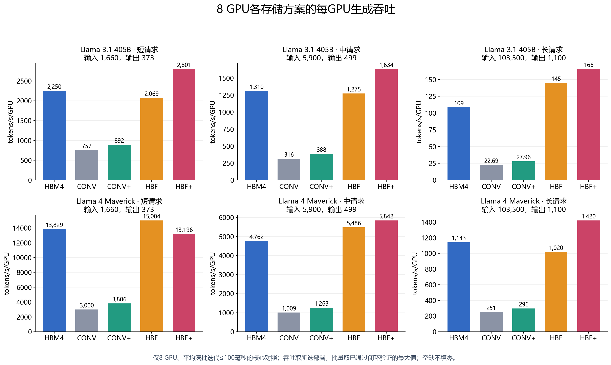
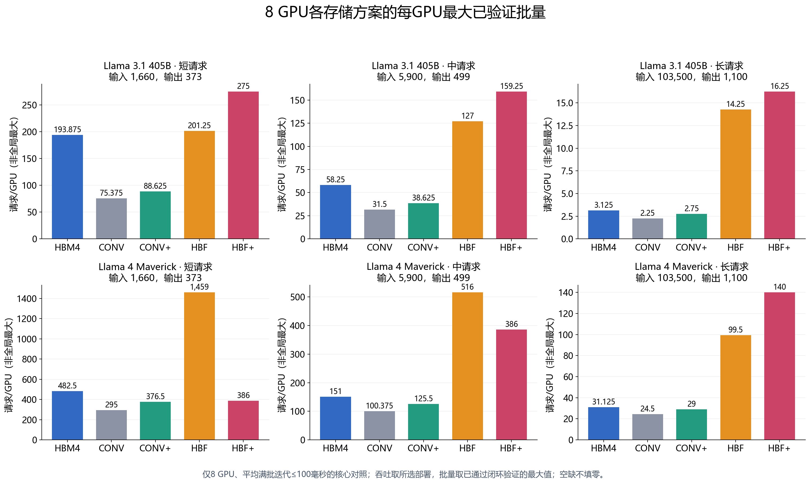

# Exploring HBF历史旁路模型结果

**后端来源更正：以下30组历史实验由独立的 `paper_*` 算子/事件模型产生，没有经过原生 `reporting.run_scenario → simulate_online → planner → UnifiedEventKernel → 物理核`。不能将其称为原生仿真器对论文的验收，也不能用来证明原生后端已支持连续补位、PD、SRAM或Maverick。原始数字保留，仅作历史探索。新的原生实现映射和实验安排见项目文档 `docs/exploring_hbf_native_comparison.md`。**

**计划配置已全部成为终态。** 当前进度 30/30；成功 30，未通过筛选 0，未找到已验收部署 0，执行失败 0，不完整终态 0。

本报告只使用当前目录中真实终态的闭环结果。搜索中或验证中的结果即使已有候选，也不计为完成；失败和不可行配置不填充吞吐数据。此前12个短物理控制实验属于另一项对照，不纳入这里的对照结果。

本轮核心对照为30个计划配置。另270个GPU数量或SLO目标的探索配置未验收，涉及1、2、4、8、16 GPU及其他SLO范围；部分初始工作已隔离保留，不纳入对照。它们保存在deferred_cases中，只有后续明确请求才运行，不计入本轮完成分母。

## 结果口径

每个候选先接受容量与中点上下文的单步Decode筛选，再执行完整闭环验证。每个选中结果包含一个输出生命周期的预热、两个输出生命周期的测量，并在请求结束前准备新请求的PD传输和KV写入。选择依据是已验证候选的最大每GPU吞吐；只验证有限个排名靠前的并行方案并按需要缩批，**不证明全局最优，也不把单步筛选误称稳态验收**。

论文仅写TPOT≤0.1秒，未公开平均、尾分位或逐步最大值的精确定义。本次主实验采用常用的稳态平均解释：`mean_iteration_ns ≤ 100毫秒`，包含补位等待；**不能断言论文原实现一定采用平均值**。严格`max_iteration_ns`逐步最大目标作为独立控制，仍在CSV中保留最大值，但不混入平均目标主曲线。`mean_tpot_ns`是请求自身相邻输出间隔，不等于系统完整迭代。硬最大值加FIFO会把稀疏整组PD阻塞变成所有请求的SLO失败，这与论文的常数稳态带宽模型不同；改变主实验解释不放松旧快速模式10%预算。

离线仅用`24小时 / 总输出长度`作为保守单步筛选门槛，最终必须验证`max_completed_request_elapsed_ns ≤ 24小时`：即新接纳fresh请求从Decode节点接纳到完成的完整驻留时间，包含其他槽位PD造成的阻塞；不包含该请求接纳前的Prefill或自身PD导入时间。作者报告第19页明确全部硬件按规定峰值性能运行，因此主实验矩阵与标量效率均设为1；旧60%效率探索记录单独保留，不混入主实验。BF16和链路启动参数仍是显式研究选择，并非论文披露的完整器件实测参数。

`infeasible`仅表示未通过声明的容量或代表事件筛选，不是物理不可行证明；`no_validated_deployment`表示有筛选候选但有限闭环尝试未找到通过部署。任何搜索执行错误均归为`failed`，不能当作硬件不可行或用零吞吐填图。

吞吐与批量分别取值：图4吞吐对照取`selected`所选吞吐最优的已验证部署；图3批量对照及batch.png取所有`accepted=true`完整闭环验证中最大的每GPU批量，**不是全局最大批量或硬件容量上限的证明**。二者可能来自不同并行方案，不能用吞吐最优部署的较小批量冒充最大已验证批量。summary.csv中`batch_per_gpu`是吞吐所选批量，`max_validated_batch_per_gpu`是最大已验证批量，并另记其并行方案。

归一化公式：`吞吐比 = 本配置所选每GPU tokens/s / 同模型同负载8 GPU HBM4所选每GPU tokens/s`；批量比使用两边各自最大已验证批量。每GPU批量为`副本批量 / (TP × PP × EP)`；DP只增加独立副本数，不再次摊薄每GPU工作量。

## 8 GPU HBM4与论文数值对照

论文第3页图3、图4的标注经过四舍五入，以下不是作者提供的原始采样值。相对差异为`|本仿真值−论文标注| / 论文标注`。它衡量跨模型差异，不能当作原快速模式的10%误差预算验收。

|模型|负载|最大已验证批量/GPU|吞吐所选批量/GPU|论文批量（约）|批量差异|所选吞吐/GPU|论文吞吐（约）|吞吐差异|
|---|---|---:|---:|---:|---:|---:|---:|---:|
|Llama 3.1 405B|短请求|193.875|193.875|194.000|0.06%|2,249.9|3,300.0|31.82%|
|Llama 3.1 405B|中请求|58.250|58.250|61.500|5.28%|1,310.4|1,800.0|27.20%|
|Llama 3.1 405B|长请求|3.125|3.125|3.750|16.67%|108.5|147.0|26.18%|
|Llama 4 Maverick|短请求|482.500|482.500|460.000|4.89%|13,828.8|19,000.0|27.22%|
|Llama 4 Maverick|中请求|151.000|151.000|151.500|0.33%|4,762.1|6,300.0|24.41%|
|Llama 4 Maverick|长请求|31.125|31.125|31.000|0.40%|1,143.5|1,300.0|12.04%|

已完成的6/6组HBM4对照中，批量相对差异范围为0.06%～16.67%，中位数2.65%。

已完成的6/6组HBM4对照中，吞吐相对差异范围为12.04%～31.82%，中位数26.69%。

以上差异是直接计算结果；未利用论文吞吐值调整计算效率、模型张量尺寸或媒体带宽。模型计算精度、有效算力、块注意力实现和容量单位均可能影响数值；接近个别标注不能证明整篇论文复现。

## HBF容量、批量与吞吐的对应关系

论文第3页报告8 GPU下，HBF相对HBM4的批量增益跨六场景为1.3～4.5倍，HBF+为1.7～5.3倍。论文没有提供每根柱的原始值，因此不为各场景编造精确目标，也不对这些范围计算逐柱相对误差。

|模型|负载|方案|最大已验证批量/GPU|吞吐所选批量/GPU|相对HBM4最大已验证批量|所选吞吐/GPU|相对HBM4所选吞吐|状态|
|---|---|---|---:|---:|---:|---:|---:|---|
|Llama 3.1 405B|短请求|HBF|201.250|201.250|1.038|2,069.4|0.920|已完成|
|Llama 3.1 405B|短请求|HBF+|275.000|275.000|1.418|2,800.6|1.245|已完成|
|Llama 3.1 405B|中请求|HBF|127.000|127.000|2.180|1,275.0|0.973|已完成|
|Llama 3.1 405B|中请求|HBF+|159.250|159.250|2.734|1,634.0|1.247|已完成|
|Llama 3.1 405B|长请求|HBF|14.250|14.250|4.560|144.9|1.336|已完成|
|Llama 3.1 405B|长请求|HBF+|16.250|16.250|5.200|165.7|1.527|已完成|
|Llama 4 Maverick|短请求|HBF|1,459.000|1,459.000|3.024|15,003.9|1.085|已完成|
|Llama 4 Maverick|短请求|HBF+|386.000|376.500|0.800|13,195.7|0.954|已完成|
|Llama 4 Maverick|中请求|HBF|516.000|509.000|3.417|5,486.0|1.152|已完成|
|Llama 4 Maverick|中请求|HBF+|386.000|386.000|2.556|5,842.0|1.227|已完成|
|Llama 4 Maverick|长请求|HBF|99.500|99.500|3.197|1,019.7|0.892|已完成|
|Llama 4 Maverick|长请求|HBF+|140.000|140.000|4.498|1,420.0|1.242|已完成|

当前HBF有6/6组有效配对：批量增益1.038～4.560倍，吞吐增益0.892～1.336倍。

当前HBF+有6/6组有效配对：批量增益0.800～5.200倍，吞吐增益0.954～1.527倍。

HBF的容量增加可让更大的批量摊销权重读取，但不保证吞吐按批量同比增加；每序列KV读取随上下文增长，PD补位写入受较低写带宽约束。HBF+删除中间数据HBM后，每堆40 MB SRAM可能先约束工作区；因此容量、并行部署、预取信用与补位停顿需要一起分析。论文研究Decode节点，不能用这里的结果推导完整长Prefill的TTFT。

**来源更正：本节只分析历史独立 `paper_*` 旁路模型；没有经过原生 serving/planner/物理执行链，不能据此验收原生后端。新实验安排见 `docs/exploring_hbf_native_comparison.md`。**

## 核心对照结论

本轮30个8 GPU、平均完整迭代不超过100毫秒的核心配置均已通过闭环验收。结论是：**部分硬件趋势相符，绝对吞吐和部分批量结果存在明显差异；这是一组独立对照，不能写成已数值复现论文。** 没有利用论文结果反调算力、带宽、模型尺寸或误差门槛。下列分析只纳入峰值效率1、正确逻辑层读暂存、动态paged KV及`exact_prepared_capacity_v1`的完整终态。

### HBM4：多数批量接近，吞吐仍偏低

批量列取所有已通过闭环验证候选中的最大每GPU批量，吞吐列取吞吐最优已验证部署。论文数值来自图中约数；有符号差异为“本仿真/论文约数−1”，不等于原快速模式的10%预测误差验收。

|模型|请求|最大已验证批量/GPU|论文约数|批量差异|所选tokens/s/GPU|论文约数|吞吐差异|
|---|---|---:|---:|---:|---:|---:|---:|
|Llama 3.1 405B|短|193.875|194|−0.06%|2,249.90|3,300|−31.82%|
|Llama 3.1 405B|中|58.250|61.5|−5.28%|1,310.40|1,800|−27.20%|
|Llama 3.1 405B|长|3.125|3.75|−16.67%|108.52|147|−26.18%|
|Llama 4 Maverick|短|482.500|460|+4.89%|13,828.84|19,000|−27.22%|
|Llama 4 Maverick|中|151.000|151.5|−0.33%|4,762.10|6,300|−24.41%|
|Llama 4 Maverick|长|31.125|31|+0.40%|1,143.48|1,300|−12.04%|

五组批量的差异不超过5.29%，但405B长请求相差16.67%；六组吞吐均低12.04%～31.82%。因此，“容量组织在多数场景接近”与“吞吐没有复现”需要同时保留。六个HBM4所选部署均没有接纳等待，满批执行比例为100%；不能将这部分吞吐差距归因于PD补位停顿。

### HBF：扩大批量成立，吞吐收益取决于工作负载

下面所有比值均相对本仿真同模型、同请求的8 GPU HBM4结果。批量比使用两边各自最大已验证批量，吞吐比使用两边各自所选吞吐。

|模型|请求|HBF批量比|HBF吞吐比|HBF+批量比|HBF+吞吐比|
|---|---|---:|---:|---:|---:|
|Llama 3.1 405B|短|1.038|0.920|1.418|1.245|
|Llama 3.1 405B|中|2.180|0.973|2.734|1.247|
|Llama 3.1 405B|长|4.560|1.336|5.200|1.527|
|Llama 4 Maverick|短|3.024|1.085|0.800|0.954|
|Llama 4 Maverick|中|3.417|1.152|2.556|1.227|
|Llama 4 Maverick|长|3.197|0.892|4.498|1.242|

HBF最大已验证批量增益范围为1.038～4.560倍，HBF+为0.800～5.200倍；论文给出的跨六场景范围分别为1.3～4.5和1.7～5.3倍。两者不能称为范围完全一致，尤其405B短请求和Maverick短请求的HBF+存在明显差异。论文没有公开逐柱原始数据，不能为每根HBF柱编造精确误差。

论文图4的文字结论是HBF与HBF+在“一个或多个GPU数量”上提供更高吞吐，并非承诺8 GPU的每个场景都更快。因此这里若干吞吐比低于1，只能说明8 GPU这一切片及当前实现的差异，不能单凭它们反驳论文的GPU扩展结论；其他GPU数量本轮尚未验收。图3的8 GPU批量范围则是可直接对照的结论。

容量扩大后，权重读取可以由更多请求分摊，但每个请求的KV读取仍随上下文增长，不会被批量摊薄。405B长请求的HBF批量是HBM4的4.56倍，吞吐只增加33.6%；Maverick长请求的HBF批量增加到3.20倍，吞吐反而低约10.8%。这说明更大批量不能直接换算为等比例吞吐。模型的Dense/MoE比例、块注意力、TP/EP布局及有限读流水都会改变收益。

### SRAM工作区解释了Maverick短请求的HBF+差异

Maverick短请求的HBF+最大已验证批量为386/GPU，低于HBM4的482.5/GPU；吞吐所选部署的批量为376.5/GPU。该部署记录的中间工作区为319.706 MB，已接近8堆共320 MB的SRAM上限。

当前实现将202,048词表的完整FP32分片输出保留到LM_HEAD结束，再执行采样归约，工作区随批量和词表大小增长。普通HBF使用HBM存放中间数据，其短请求批量达到1,459/GPU，因此同一模型下反而高于HBF+。这是当前明确的结构与调度差异，不应解释为“HBF+介质本身更慢”。流式词表投影和采样可减少存活工作区，但论文未公开其具体实现，本轮没有为了追求曲线一致而追加该机制。

### 传统NAND对照支持读取通路的重要性

全部六个场景中，CONV吞吐仅为HBM4的20.9%～33.6%，CONV+为25.8%～39.6%；HBF相对CONV快约2.73～6.39倍，HBF+相对CONV+快约3.14～5.93倍。该方向支持论文的核心动机：大容量本身不够，读取并行性、读延迟和数据通路同样重要。它不意味着带宽或容量比可以直接当作吞吐比。

### 耐久性投影的方向相符

12个HBF/HBF+配置的三年均匀磨损投影约为14.9万～42.5万次P/E，均高于论文讨论的10万次量级，支持“持续KV写入带来耐久性压力”的方向。这里按稳态编程字节率除以可用NAND容量换算，未模拟真实GC写放大、擦除或磨损均衡；它不是器件寿命实测，也不等于逐块擦除计数。

### 解释边界

全部30个所选部署都保持满批，接纳等待为0。PD传输与编程仍实际占用资源；准备窗口和准备KV池使这些工作在本轮所选部署中被掩蔽，不能因为资源服务量较大就认定它造成关键路径停顿。

作者报告明确按峰值性能运行，本轮据此采用计算效率1。仍未唯一确定的精度、GB/GiB单位、算子融合、输出采样工作区、互连调度和有限顶候选搜索范围，均可能形成差异；本轮没有逐项敏感性实验，不能指定某一项解释全部数值偏差，也不能声称搜索到了全局最优部署。

本后端是面向论文参数建立的独立批量/算子及有限缓冲带宽事件模型，不等同于作者未公开的扩展实现，也不是OCP逐事务FTL模型。它未模拟GC复制、擦除和真实磨损分布，也未执行完整Prefill，不能据此验证长Prefill的TTFT、原物理仿真器的GC时序或真实器件寿命。阶段跨度可能重叠，不作为图5关键路径分解的数值复现。

本轮只完成8 GPU、100毫秒平均迭代目标的30个核心配置。其余GPU数量和SLO探索范围共270个配置尚未完成整体验收；其中4个额外终态和2个未完成记录已独立保存在`exploratory_deferred/points`，均不纳入本次对照，后续只有明确请求才继续。旧60%效率、错误staging及固定预留控制结果也不混入本轮主结果。

## 机制覆盖与仍存在的未知项

|机制|本次执行与边界|
|---|---|
|模型张量|405B来自Meta官方SKU；Maverick来自Meta torchtune专用builder，包含交替Dense/MoE、Top-1、共享专家及3:1固定块/全注意力。官方HF checkpoint受门控，未下载逐张量核验。|
|私有存储容量|按每GPU和每PP阶段计算TP/EP权重、GQA头复制和工作区；活动KV采用真实错相年龄的paged pool，对各生命周期相位的full/chunk加权占用逐相位求峰值，不再为全部序列同时预留最大长度。有限准备KV池另加，不把所有GPU容量当作一个共享池。|
|HBF读流水|有限阵列准备资源支付tREAD，再经独立数据端口传输；每堆3.13 MB SRAM拆成两个有限读缓冲，填充、消耗和释放分别付费，没有无限阵列准备、无限预取或隐藏HBM溢出。当前MB按十进制解释，3.13 MB=3,130,000字节；论文未消歧的二进制单位应另列敏感性，不自动改字节数。|
|NAND写服务|接收链路单独付费，编程阵列占用为max(tPROG，字节数/论文写带宽)，不把已含编程吞吐的写带宽再叠加一次完整tPROG。|
|中间数据|HBF/CONV使用HBM；HBF+/CONV+使用每堆40 MB逻辑层SRAM，具有显式生命周期与容量。|
|词表输出工作区|当前LM_HEAD在每个TP分片完整保留FP32词表输出，再执行采样归约；这不是论文公开的必选实现。Maverick的202,048词表可能先占满HBF+的320 MB中间SRAM，限制批量。流式词表投影/采样可减少存活工作区，但本轮未实现，也不为追求相同数值而新增。|
|并行与通信|DP、TP、PP、EP及微批逐资源执行；GPU注入/接收、跨节点链路及PD接收共享相应资源日历。|
|PD与主机暂存|采用有限HOST DRAM双缓冲流式导入；64 MiB容量与200 GB/s带宽属于研究补充值，HOST不是新增HBM。每段接收、暂存、读出和GPU写入有真实依赖与缓冲信用。|
|闭环服务|完成请求的槽位保持稳定；新请求KV必须实际完成PD传输和存储写入才可接纳。提前准备窗口由实际PD费用推导，对应准备KV池计入容量；不固定为两步，也不靠修改缓存长度跳过写入。|
|执行粒度|独立的论文批量/算子事件后端；有限缓冲重复转移可精确加速，不调用旧单请求快速预测。它不等同于OCP逐事务FTL仿真。|
|作者方法补充|作者报告第19页明确GPU核心、存储堆栈与互连均按规定峰值性能运行，主实验矩阵与标量效率为1；第20页说明零停顿批处理和更高性能Prefill节点。旧60%效率探索记录单独保留，不能作为当前主实验基线。|
|未披露输入|BF16、SRAM端口、链路启动时延、均匀专家路由等仍为研究补充假设；不把未知量反调到论文曲线。|
|计算侧补充来源|NVIDIA HGX官方Rubin单GPU规格提供dense BF16 4 PFLOPS、FP32向量130 TFLOPS，均为峰值上限且规格仍可能变化；主实验采用作者报告的峰值假设。官网22 TB/s HBM带宽不用于替换论文Table I的12.8 TB/s，也不把官方较新的链路规格代入论文配置。|
|容量单位|主实验明确GB=10⁹字节。Maverick BF16文本权重约801.424 GB=746.384 GiB，与论文746 GB接近只能作为单位歧义线索；GiB须单列敏感性实验，不自动缩减张量。|
|搜索与稳态|全部声明的离散并行布局先筛选；提前准备窗口由实际PD费用推导后，再对对应准备KV池逐策略二分容量边界，复用相同候选的已完成闭环结果。只对有限顶候选完整闭环验收，不证明全局最大吞吐或无限运行周期稳态。|
|GC与耐久性|此后端使用论文带宽抽象，没有虚构FTL、擦除、GC复制或真实磨损分布；原NAND物理后端保持独立。|

第4页图5的延迟分解尚不能宣称复现：当前按阶段/微批记录的时间跨度可互相重叠；PD资源服务占用也不是关键路径延迟。不得将这些项相加后归一化为图5柱图。

## 写入完成窗口与三年磨损投影

编程量按测量窗口中的Decode写入，加PD导入**完整import组完成**时记账的编程字节；通过窗口起止未完成导入的字节守恒修正，不用仅发起量或仅接纳量代替。一个未完成import组可能已完成部分编程，因此这不是逐页完成时刻的精确计数。启动导入与预热不混入测量窗口。

公式：`三年平均P/E投影 = (窗口内Decode编程字节 + 窗口内完成PD编程字节) / 窗口秒数 × (3×365×24×3600) / 副本可用HBF总字节`。DP独立同分布时，分子分母同倍缩放。它是假定均匀磨损的研究投影，不是真实FTL擦除计数、GC写放大预测或器件寿命保证。

令A为Decode编程与完整PD组完成字节之和、S/E为窗口起止尚未完成import组的编程字节，则部分编程边界的保守范围为`max(0,A−S) ≤ 实际窗口编程字节 ≤ A+E`。相同时间和容量换算得到下表P/E上下界；组完成口径投影不可冒充逐页精确值。

|模型|负载|方案|窗口秒数|PD组完成编程GB|Decode编程GB|组完成P/E投影|P/E下界|P/E上界|
|---|---|---|---:|---:|---:|---:|---:|---:|
|Llama 3.1 405B|短请求|CONV|74.28|1,036.630|234.085|56,446.7|56,446.7|56,446.7|
|Llama 3.1 405B|短请求|CONV+|74.15|1,218.255|274.125|58,110.7|58,110.7|58,110.7|
|Llama 3.1 405B|短请求|HBF|72.55|1,382.745|311.086|154,080.2|154,080.2|154,080.2|
|Llama 3.1 405B|短请求|HBF+|73.25|944.961|211.754|182,366.4|182,366.4|182,366.4|
|Llama 3.1 405B|中请求|CONV|99.47|1,537.708|131.856|55,382.0|55,382.0|55,382.0|
|Llama 3.1 405B|中请求|CONV+|99.38|1,887.879|160.700|59,518.3|59,518.3|59,518.3|
|Llama 3.1 405B|中请求|HBF|99.41|3,099.776|261.652|223,145.2|223,145.2|223,145.2|
|Llama 3.1 405B|中请求|HBF+|97.26|3,888.422|329.641|250,421.3|250,421.3|250,421.3|
|Llama 3.1 405B|长请求|CONV|218.17|1,922.974|27.250|29,495.2|29,495.2|29,495.2|
|Llama 3.1 405B|长请求|CONV+|216.38|2,350.301|27.250|31,724.9|31,724.9|31,724.9|
|Llama 3.1 405B|长请求|HBF|216.30|12,178.833|136.249|187,865.1|187,865.1|187,865.1|
|Llama 3.1 405B|长请求|HBF+|215.77|13,888.143|154.416|187,904.3|187,904.3|187,904.3|
|Llama 4 Maverick|短请求|CONV|73.22|1,541.768|346.140|85,075.2|85,075.2|85,075.2|
|Llama 4 Maverick|短请求|CONV+|73.79|1,971.270|442.355|94,442.6|94,442.6|94,442.6|
|Llama 4 Maverick|短请求|HBF|72.54|7,638.999|1,711.927|425,339.7|425,339.7|425,339.7|
|Llama 4 Maverick|短请求|HBF+|21.28|1,971.270|442.355|327,397.2|327,397.2|327,397.2|
|Llama 4 Maverick|中请求|CONV|99.32|1,867.579|158.542|67,314.4|67,314.4|67,314.4|
|Llama 4 Maverick|中请求|CONV+|99.14|2,333.894|197.785|73,731.9|73,731.9|73,731.9|
|Llama 4 Maverick|中请求|HBF|92.60|9,465.496|798.987|365,774.2|365,774.2|365,774.2|
|Llama 4 Maverick|中请求|HBF+|65.94|7,179.161|605.911|340,865.5|340,865.5|340,865.5|
|Llama 4 Maverick|长请求|CONV|215.04|2,294.538|86.508|36,536.1|36,536.1|36,536.1|
|Llama 4 Maverick|长请求|CONV+|215.86|2,721.837|100.349|37,748.4|37,748.4|37,748.4|
|Llama 4 Maverick|长请求|HBF|214.68|9,324.488|346.030|148,638.5|148,638.5|148,638.5|
|Llama 4 Maverick|长请求|HBF+|216.90|13,123.353|484.442|181,138.0|181,138.0|181,138.0|

## 来源与可复算文件

- [用户提供的论文PDF](C:/Users/A/Downloads/HBF_HBM_LLM_2026-10-15/01_HBF/HBF05_2026_Exploring_HBF.pdf)：第2页Table I、方法和SRAM组织；第3页图3/图4批量与吞吐；第4页图5与三年P/E讨论。
- [作者论文主源](https://arxiv.org/abs/2608.13868)。所有HBM4参考数值均为图中约数；HBF/HBF+只提供跨六场景范围。
- [作者方法报告](https://people.inf.ethz.ch/omutlu/pub/HBF-for-LLM-cal26-talk.pdf)：PDF第19页（索引18）明确全部硬件按规定峰值性能运行，第20页（索引19）说明假定高性能Prefill节点以支持零停顿批处理；主实验据此使用效率1。
- [Meta官方Maverick构建](https://raw.githubusercontent.com/meta-pytorch/torchtune/main/torchtune/models/llama4/_model_builders.py)与[算子组件](https://raw.githubusercontent.com/meta-pytorch/torchtune/main/torchtune/models/llama4/_component_builders.py)。
- [NVIDIA HGX官方规格](https://www.nvidia.com/en-gb/data-center/hgx/)：仅补充Rubin dense BF16 4 PFLOPS及FP32 130 TFLOPS算力来源，不用官网22 TB/s替换论文存储带宽。
- `manifest.json`保存实际计划及论文硬件目录；`points/*.json`保存全部终态、筛选、闭环候选、研究假设和资源计数。
- `summary.csv`保存全部终态的绝对指标及主实验归一化值；`8GPUcomparison.csv`保存约数对照、相对差异和HBF增益范围。
- 原40个保留结果、32个取消点及旧12个短控制实验不在本次统计中，未重启旧扫描。

生成时间：2026-10-19 14:55:10 UTC
